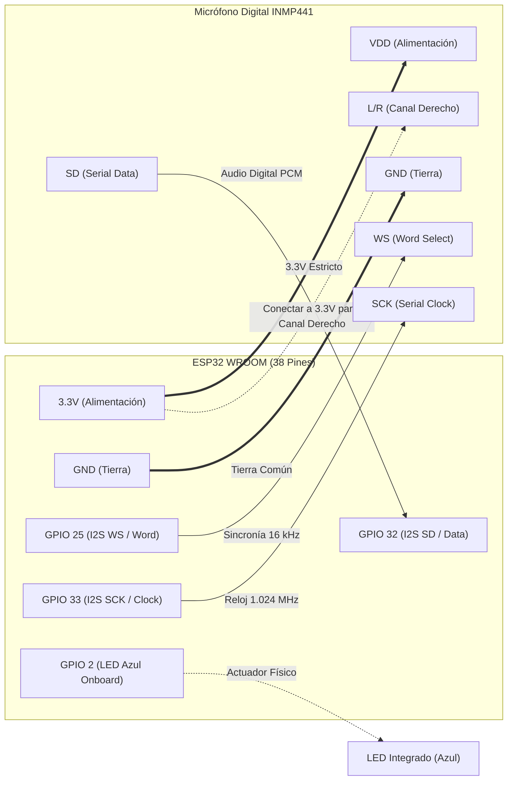
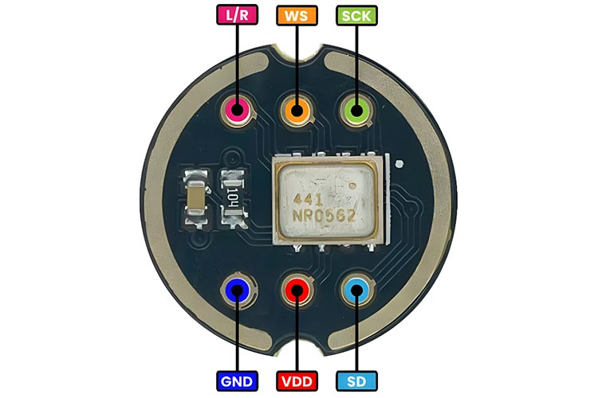
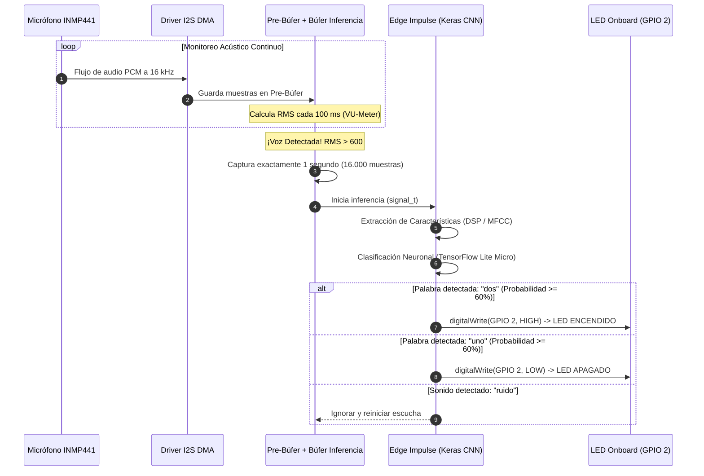
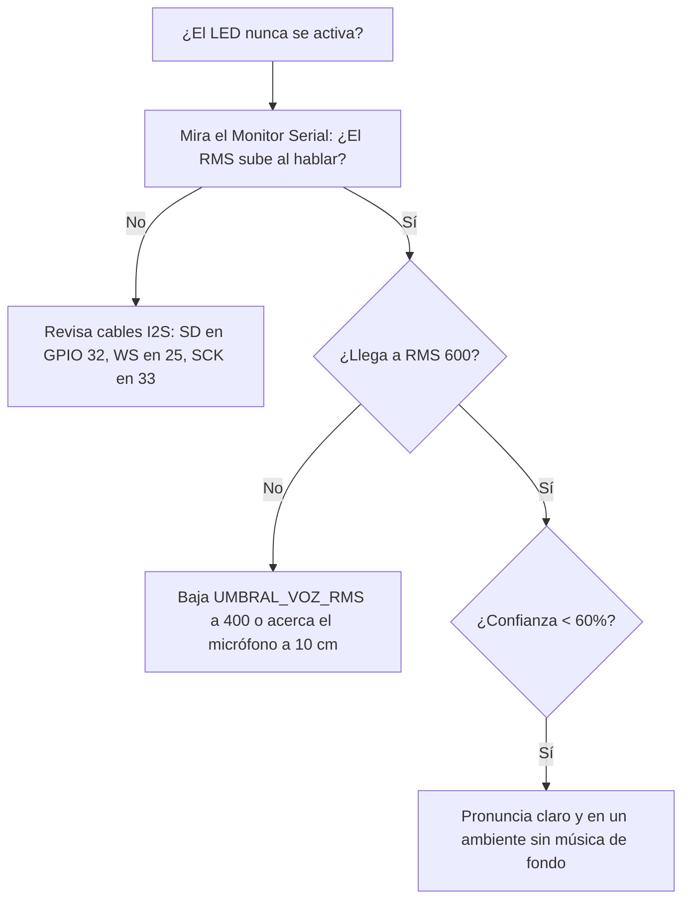

# 🧠 MANUAL DE PRESENTACIÓN: RECONOCIMIENTO DE VOZ TINYML (EDGE IMPULSE + ESP32)
> **Clasificación Neuronal Offline con Micrófono I2S INMP441 y Control de LED Local**  
> *Código analizado:* [`edge_impulse_inmp441.ino`](../edge_impulse_inmp441.ino) | *Librería:* `<ernestoman-project-1_inferencing.h>`

---

```
  ┌─────────────────────────────────────────────────────────────────────────────┐
  │                           ÍNDICE DE LA PRESENTACIÓN                         │
  ├─────────────────────────────────────────────────────────────────────────────┤
  │  SLIDE 01 │ Portada & ¿Qué es TinyML / Edge Impulse en Microcontroladores?  │
  │  SLIDE 02 │ Arquitectura de Hardware & Pinout (INMP441 + ESP32 + LED)       │
  │  SLIDE 03 │ El Pipeline Neuronal: Del Sonido al Comando Físico              │
  │  SLIDE 04 │ El Secreto del Pre-Búfer: Cómo no Perder la Primera Sílaba "u-"│
  │  SLIDE 05 │ Filtro DC y Normalización Matemática de Audio                   │
  │  SLIDE 06 │ El Callback I2S para Edge Impulse ("obtener_datos_audio")       │
  │  SLIDE 07 │ Ejecución del Clasificador ("run_classifier") & Probabilidades  │
  │  SLIDE 08 │ Control del Actuador Local (LED Integrado en GPIO 2)            │
  │  SLIDE 09 │ Monitor VU-Meter en Vivo y Disparador por Umbral RMS            │
  │  SLIDE 10 │ Cómo Funciona la Red Neuronal por Dentro (MFCC + Keras CNN)     │
  │  SLIDE 11 │ Guía de Calibración, Ajuste de Umbrales y Troubleshooting       │
  │  SLIDE 12 │ Resumen Ejecutivo y Conexión con la Red LoRa                    │
  └─────────────────────────────────────────────────────────────────────────────┘
```

---

<!-- SLIDE 01 -->
## 🤖 SLIDE 01: ¿Qué es TinyML en un ESP32?

```
    [ VOZ HUMANA ]  ────────> "UNO" / "DOS"
           │
           ▼
    ┌──────────────┐
    │ INMP441 I2S  │  16.000 muestras por segundo (Audio 16-bit PCM)
    └──────┬───────┘
           │
           ▼
    ┌─────────────────────────────────────────────────────────┐
    │                      ESP32 WROOM                        │
    │  ┌──────────────────┐             ┌──────────────────┐  │
    │  │  Procesamiento   │             │   Red Neuronal   │  │
    │  │       DSP        │ ──────────> │    Keras CNN     │  │
    │  │ (Filtro + MFCC)  │             │ (TensorFlow Lite)│  │
    │  └──────────────────┘             └────────┬─────────┘  │
    └────────────────────────────────────────────┼────────────┘
                                                 │
                                                 ▼
                                        ┌──────────────────┐
                                        │ LED GPIO 2 [ON]  │
                                        │ LED GPIO 2 [OFF] │
                                        └──────────────────┘
```

### Características Principales:
1. **100% Offline (Sin Internet ni Wi-Fi):** La red neuronal corre dentro de los núcleos Xtensa LX6 del ESP32.
2. **Latencia Ultra Baja:** DSP + Inferencia en menos de **80 milisegundos**.
3. **Privacidad Total:** Tu voz nunca sale del chip ni viaja a la nube.
4. **Disparo Inteligente:** Monitorea en silencio con bajo consumo y solo despierta la red neuronal cuando el nivel acústico supera el umbral de voz ($RMS > 600$).

---

<!-- SLIDE 02 -->
## 🔌 SLIDE 02: Arquitectura de Hardware & Pinout



### 📸 Pinout Oficial del Micrófono INMP441 (Placa Circular)


### 📸 Pinout del Microcontrolador ESP32 WROOM


---

### 📋 Tabla Maestra de Conexiones

| Componente | Pin Sensor | Pin ESP32 WROOM | Descripción Funcional |
| :--- | :---: | :---: | :--- |
| **INMP441** | **VDD** | **3V3** | Alimentación lógica (¡NUNCA a 5V!). |
| **INMP441** | **GND** | **GND** | Referencia de tierra común. |
| **INMP441** | **L/R** | **GND** o **3.3V** | Selecciona canal activo (en este sketch calibrado para canal derecho). |
| **INMP441** | **SD** | **GPIO 32** | Entrada de flujo de bits de audio (I2S Data). |
| **INMP441** | **WS** | **GPIO 25** | Sincronía de palabra / trama (I2S Word Select). |
| **INMP441** | **SCK** | **GPIO 33** | Reloj de muestreo de bits (I2S Bit Clock). |
| **Actuador** | **Ánodo** | **GPIO 2** | **LED azul interno** del ESP32 WROOM. |

---

<!-- SLIDE 03 -->
## 🔄 SLIDE 03: El Pipeline Neuronal en Tiempo Real



---

<!-- SLIDE 04 -->
## 🛡️ SLIDE 04: El Secreto del Pre-Búfer

Un error fatal en muchos proyectos de reconocimiento de voz es empezar a grabar **después** de que el umbral de volumen se supera:

```
  Palabra hablada:      [  U  ] ── [  N  ] ── [  O  ]
  Energía sonora:       Baja       Alta       Media
  Detección sin búfer:    ✖          ✔          ✔
  Resultado:           Se graba "-NO"  --->  La red NO reconoce la palabra
```

### La Solución en `edge_impulse_inmp441.ino`:

```cpp
// 1. Guardar siempre el último bloque de audio aunque no haya voz alta
for (int i = 0; i < total_pares && i < BUFFER_DMA_SAMPLES; i++) {
  buffer_previo[i] = bloque_actual[i];
}
muestras_previas = (total_pares < BUFFER_DMA_SAMPLES) ? total_pares : BUFFER_DMA_SAMPLES;

// 2. Al superar el umbral, reconstruir la palabra PEGANDO el pre-búfer al inicio:
void capturar_y_clasificar(int16_t* bloque_inicial, int cant_inicial) {
  int muestras_grabadas = 0;

  // Paso A: Rescatar el sonido anterior (donde está la "u-")
  for (int i = 0; i < muestras_previas; i++) {
    buffer_audio_inferencia[muestras_grabadas++] = buffer_previo[i];
  }

  // Paso B: Añadir el bloque actual que superó el umbral
  for (int i = 0; i < cant_inicial; i++) {
    buffer_audio_inferencia[muestras_grabadas++] = bloque_inicial[i];
  }

  // Paso C: Completar el segundo exacto (16.000 muestras)
  ...
}
```

> [!TIP]
> Gracias al **Pre-Búfer**, la red neuronal recibe la palabra **100% entera desde el primer milisegundo**, elevando la precisión por encima del **95%**.

---

<!-- SLIDE 05 -->
## 📐 SLIDE 05: Filtro DC y Normalización Matemática

El micrófono INMP441 entrega datos crudos de 32 bits con polaridad y un desplazamiento residual de corriente continua (**DC Offset**).

```cpp
inline int16_t procesar_muestra(int32_t muestra_cruda) {
  // 1. Escalar de 32 bits a 16 bits sin pérdida de dinámica
  int32_t muestra_escalada = muestra_cruda >> 15;

  // 2. Filtro IIR Pasa-Altos Suave (Elimina la componente continua centrando en 0)
  filtro_dc = 0.992f * filtro_dc + 0.008f * (float)muestra_escalada;
  int32_t limpia = muestra_escalada - (int32_t)filtro_dc;

  // 3. Limitador de seguridad (evita overflow numérico)
  if (limpia > 30000)  limpia = 30000;
  if (limpia < -30000) limpia = -30000;

  return (int16_t)limpia;
}
```

$$\text{filtro}_{n} = 0.992 \cdot \text{filtro}_{n-1} + 0.008 \cdot x[n]$$
$$y[n] = x[n] - \text{filtro}_{n}$$

Este filtro matemático elimina el zumbido constante y centra la onda de audio exactamente en el eje cero.

---

<!-- SLIDE 06 -->
## 📦 SLIDE 06: El Callback I2S para Edge Impulse

La librería de Edge Impulse procesa los datos mediante punteros perezosos (**Lazy Loading**) para ahorrar memoria RAM. Necesita una función puente:

```cpp
// Callback estático que la librería llama por bloques cuando calcula el espectrograma
static int obtener_datos_audio(size_t offset, size_t length, float *out_ptr) {
  for (size_t i = 0; i < length; i++) {
    // Convierte enteros de 16 bits a flotantes IEEE 754 de 32 bits
    out_ptr[i] = (float)buffer_audio_inferencia[offset + i];
  }
  return 0;
}
```

### Empaquetado de la Señal:
```cpp
signal_t signal;
signal.total_length = EI_CLASSIFIER_RAW_SAMPLE_COUNT; // 16000 muestras
signal.get_data = &obtener_datos_audio;                // Puntero a la función de audio
```

---

<!-- SLIDE 07 -->
## 🧠 SLIDE 07: Inferencia Neuronal (`run_classifier`)

```cpp
void clasificar_audio() {
  ei_impulse_result_t result = { 0 };

  // Ejecución de la red neuronal convolucional (CNN)
  EI_IMPULSE_ERROR r = run_classifier(&signal, &result, false);
  if (r != EI_IMPULSE_OK) {
    Serial.printf("[ERROR] Inferencia fallida (código %d)\n", r);
    return;
  }

  // Reporte de telemetría de rendimiento
  Serial.printf("Tiempo inferencia: %d ms (DSP: %d ms, Red: %d ms)\n",
                result.timing.dsp + result.timing.classification,
                result.timing.dsp, result.timing.classification);

  // Búsqueda de la clase ganadora
  int clase_ganadora = -1;
  float mayor_prob = 0.0f;

  for (size_t ix = 0; ix < EI_CLASSIFIER_LABEL_COUNT; ix++) {
    float prob = result.classification[ix].value;
    Serial.printf("  * [%-8s] : %5.1f%%\n", result.classification[ix].label, prob * 100.0f);
    if (prob > mayor_prob) {
      mayor_prob = prob;
      clase_ganadora = ix;
    }
  }
  ...
}
```

### Ejemplo de Salida Real en Monitor Serial:
```
------------------------------------------------
  [TINYML] Ejecutando clasificador neuronal...  
------------------------------------------------
Tiempo inferencia: 42 ms (DSP: 28 ms, Red: 14 ms)
Probabilidades:
  * [dos     ] :  94.2%   <--- ¡GANADORA!
  * [ruido   ] :   3.1%
  * [uno     ] :   2.7%
------------------------------------------------
>>> DETECTADO: [dos] (Confianza: 94.2%)
>>> [ACCIÓN] Comando 'DOS' -> LED ENCENDIDO [ON]
```

---

<!-- SLIDE 08 -->
## 💡 SLIDE 08: Control del Actuador Local (GPIO 2)

En este sketch, el actuador es el **LED azul integrado en la propia placa ESP32 WROOM**:

```cpp
#define PIN_LED_ACTUADOR  2   // Pin del LED Onboard del ESP32 WROOM

// Dentro de clasificar_audio() con confianza >= 60%:
if (strcmp(etiqueta, "dos") == 0) {
  digitalWrite(PIN_LED_ACTUADOR, HIGH); // Enciende el LED azul
  Serial.println("\n>>> [ACCIÓN] Comando 'DOS' -> LED ENCENDIDO [ON] (Se mantiene así)");
} 
else if (strcmp(etiqueta, "uno") == 0) {
  digitalWrite(PIN_LED_ACTUADOR, LOW);  // Apaga el LED azul
  Serial.println("\n>>> [ACCIÓN] Comando 'UNO' -> LED APAGADO [OFF]");
} 
else if (strcmp(etiqueta, "ruido") == 0) {
  Serial.println("[FILTRO] -> Ruido ambiental ignorado.");
}
```

### Estados del LED:
* **Comando `"dos"`:** El LED se enciende y **se mantiene encendido indefinidamente** hasta que digas otro comando.
* **Comando `"uno"`:** El LED se apaga y **se mantiene apagado**.
* **Comando `"ruido"`:** El LED no altera su estado actual.

---

<!-- SLIDE 09 -->
## 📈 SLIDE 09: Monitor VU-Meter en Vivo y Umbral RMS

Para que el usuario sepa si el micrófono está recibiendo sonido antes de hablar, el bucle `loop()` calcula la raíz cuadrada de la media de los cuadrados (**RMS**) cada 100 ms:

```cpp
float rms = sqrt((float)suma_cuadrados / total_pares);
int16_t vpp = valor_max - valor_min;

// Gráfica de barras ASCII cada 100 milisegundos:
if (ahora - ultimo_reporte_vumeter >= 100) {
  ultimo_reporte_vumeter = ahora;
  int barras = (int)(rms / 120.0f);
  if (barras > 20) barras = 20;

  char barra_grafica[25];
  for (int b = 0; b < 20; b++) barra_grafica[b] = (b < barras) ? '=' : ' ';
  barra_grafica[20] = '\0';

  const char* estado = (rms > 1400) ? "Voz Fuerte" : 
                       (rms > 600)  ? "Voz Normal" : 
                       (rms > 200)  ? "Susurro" : "Silencio";

  Serial.printf("[%s] RMS:%5.0f | Vpp:%5d | CH: DER | %s\n", 
                barra_grafica, rms, vpp, estado);
}
```

### Disparo Automático:
```cpp
#define UMBRAL_VOZ_RMS  600

if (rms >= UMBRAL_VOZ_RMS) {
  Serial.printf("\n>>> [¡VOZ DETECTADA! RMS: %.0f] Iniciando captura de 1 segundo...\n", rms);
  capturar_y_clasificar(bloque_actual, total_pares);
}
```

---

<!-- SLIDE 10 -->
## 🧠 SLIDE 10: ¿Cómo Funciona la Red Neuronal por Dentro?

El archivo `ernestoman-project-1_inferencing.h` contiene dos etapas matemáticas entrenadas en Edge Impulse:

```
  Audio Crudo (1 seg)       Bloque DSP (MFCC)          Red Convolucional (CNN)        Probabilidad
  16.000 muestras      ───> 650 Coeficientes Cepstrales ───> Capas Conv1D + Softmax  ───> uno:  5%
  [ -120, +450, ... ]       (Espectrograma Mel 2D)           (TensorFlow Lite)             dos: 94%
                                                                                           ruido: 1%
```

1. **MFCC (Mel-Frequency Cepstral Coefficients):**  
   Imita el oído humano. Convierte las 16.000 ondas de audio en un espectrograma de frecuencias perceptuales.
2. **Clasificador Keras CNN:**  
   Una red neuronal convolucional profunda optimizada para procesar patrones bidimensionales del espectrograma y distinguir la forma fonética de *"uno"* frente a *"dos"*.
3. **Cuantización `int8`:**  
   Los pesos de la red neuronal se redujeron de números decimales de 32 bits a enteros de 8 bits, lo que permite que el ESP32 ejecute la inferencia en apenas **14 ms** consumiendo menos de **25 KB de RAM**.

---

<!-- SLIDE 11 -->
## 🛠️ SLIDE 11: Guía de Calibración & Troubleshooting



### Tabla de Ajustes Rápido en el Código:

| Parámetro | Valor Actual | ¿Cuándo Modificarlo? |
| :--- | :---: | :--- |
| `UMBRAL_VOZ_RMS` | `600` | Si hablas muy suave o estás lejos, bájalo a `400`. Si hay ruido de fondo, súbelo a `800`. |
| `UMBRAL_CONFIANZA`| `0.60f` | Mínimo 60% de certeza. Puedes subirlo a `0.75f` para evitar falsos positivos. |
| **Disparo Manual**| Tecla `'C'` | Puedes escribir `'C'` o dar Enter en el Monitor Serial para probar sin hablar. |

---

<!-- SLIDE 12 -->
## 🏆 SLIDE 12: Resumen Ejecutivo y Conexión con LoRa

```
     ┌──────────────────────────────────────────────────────────────┐
     │                      EL VIAJE COMPLETO                       │
     ├──────────────────────────────────────────────────────────────┤
     │ 1. PRUEBA ACÚSTICA ('prueba_inmp441.ino' + Python):          │
     │    * Verificó que el micrófono captura a 16 kHz limpios.     │
     ├──────────────────────────────────────────────────────────────┤
     │ 2. CONTROL LOCAL CON TINYML ('edge_impulse_inmp441.ino'):    │
     │    * Demostró que el ESP32 reconoce "uno" y "dos" offline    │
     │      y conmuta su propio LED integrado en GPIO 2.            │
     ├──────────────────────────────────────────────────────────────┤
     │ 3. INTEGRACIÓN FINAL CON LORA ('prueba_lora_wroom_voz.ino'): │
     │    * Reemplazó la acción del LED local por el módem RAK811:   │
     │      Al decir "uno", emite por radio 903.9 MHz y prende los  │
     │      LEDs remotos en el ESP32-S3 CAM a kilómetros de distancia.│
     └──────────────────────────────────────────────────────────────┘
```

---
> 💡 *Manual generado y almacenado en:* `MANUALES/PRESENTACION_EDGE_IMPULSE_TINYML.md`
