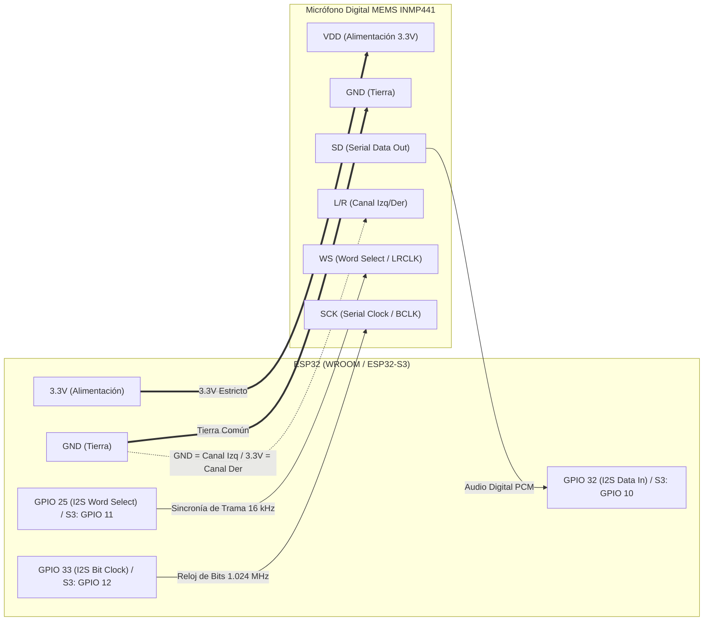
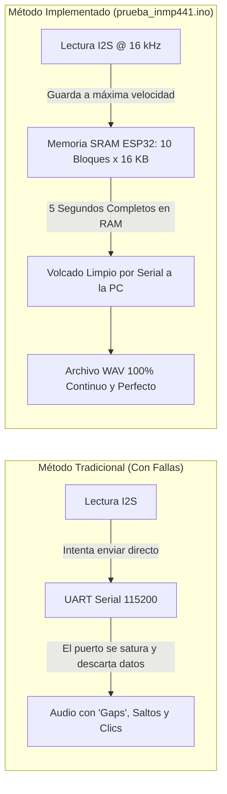
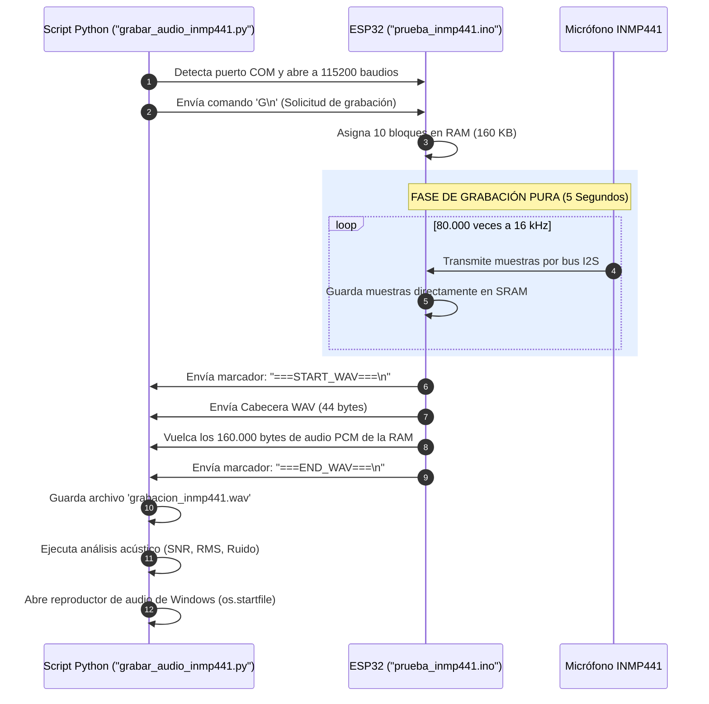

# 🎙️ MANUAL DE PRESENTACIÓN: MICRÓFONO I2S INMP441 + ESP32 & PYTHON
> **Captura Digital de Audio de Alta Fidelidad, Bufferizado en RAM y Análisis Acústico en PC**  
> *Códigos analizados:* [`prueba_inmp441.ino`](../prueba_inmp441.ino) & [`grabar_audio_inmp441.py`](../grabar_audio_inmp441.py)

---

```
  ┌─────────────────────────────────────────────────────────────────────────────┐
  │                           ÍNDICE DE LA PRESENTACIÓN                         │
  ├─────────────────────────────────────────────────────────────────────────────┤
  │  SLIDE 01 │ Portada & Visión General del Pipeline de Audio                  │
  │  SLIDE 02 │ Hardware & Pinout del INMP441 (Conexión al ESP32)               │
  │  SLIDE 03 │ El Protocolo I2S Digital vs Micrófonos Analógicos               │
  │  SLIDE 04 │ Auto-Detección Inteligente de Canal (L/R) y Filtro DC           │
  │  SLIDE 05 │ Grabación en RAM Bufferizada (Cero Pérdidas ni Audio Robótico)  │
  │  SLIDE 06 │ Construcción de la Cabecera Binaria WAV (44 Bytes)              │
  │  SLIDE 07 │ Modos Interactivos del Monitor Serial: VU-Meter, Plotter y Grab │
  │  SLIDE 08 │ Comunicación Bidireccional ESP32 <-> Script Python              │
  │  SLIDE 09 │ Análisis Matemático de Calidad Acústica (SNR, RMS, dBFS)        │
  │  SLIDE 10 │ Del Audio Limpio al Reconocimiento de Voz TinyML (Edge Impulse) │
  └─────────────────────────────────────────────────────────────────────────────┘
```

---

<!-- SLIDE 01 -->
## 🎵 SLIDE 01: Visión General del Pipeline de Audio

```
  [ VOZ / SONIDO ]
         │
         ▼
 ┌────────────────┐         I2S Digital (16 kHz / 24-bit)        ┌─────────────────┐
 │ INMP441 (MEMS) │ ───────────────────────────────────────────> │  ESP32 (WROOM)  │
 └────────────────┘   SCK (Reloj), WS (Trama), SD (Datos)       │ Captura en SRAM │
                                                                 └────────┬────────┘
                                                                          │
                                 UART Serial @ 115200 (WAV Stream)        │
                                 "===START_WAV===" + 160.044 Bytes        │
                                                                          ▼
 ┌─────────────────────────────────────────────────────────────────────────────────┐
 │                             SCRIPT PYTHON EN PC                                 │
 │                          ("grabar_audio_inmp441.py")                            │
 ├────────────────────────────────┬────────────────────────────────────────────────┤
 │ 1. Recepción y guardado .WAV   │ Genera 'grabacion_inmp441.wav' sin pérdidas    │
 │ 2. Análisis Acústico           │ Calcula Pico Máximo, RMS, Ruido Base y SNR     │
 │ 3. Reproducción Inmediata      │ Abre el reproductor de Windows automáticamente │
 └────────────────────────────────┴────────────────────────────────────────────────┘
```

### ¿Por qué esta solución es superior?
* **Sin ruido analógico:** A diferencia de micrófonos como el MAX4466 o KY-037 que usan el ADC del ESP32 (muy ruidoso y no lineal), el **INMP441 es 100% digital**.
* **Cero cortes:** Graba primero 5 segundos completos dentro de la memoria **SRAM del ESP32 (160 KB)** y luego los transmite a la PC. Esto evita que la lentitud del puerto serie deforme la voz.

---

<!-- SLIDE 02 -->
## 🔌 SLIDE 02: Arquitectura de Hardware & Pinout



### 📸 Pinout Oficial del Micrófono INMP441 (Placa Circular)


### 📸 Pinouts de los Microcontroladores Utilizados
| ESP32 WROOM (38 Pines) | Freenove ESP32-S3 WROOM CAM |
| :---: | :---: |
|  |  |

---

### 📋 Tabla Maestra de Conexiones I2S

| Pin INMP441 | Color en Diagrama | Pin ESP32 WROOM | Pin ESP32-S3 | Función en el Bus I2S |
| :--- | :---: | :---: | :---: | :--- |
| **VDD** | 🔴 Rojo | **3.3V (3V3)** | **3.3V (3V3)** | Alimentación lógica. **¡NUNCA conectar a 5V!** |
| **GND** | 🔵 Azul | **GND** | **GND** | Masa o tierra de referencia común. |
| **SD** | 🔷 Celeste | **GPIO 32** | **GPIO 10** | **Serial Data (DOUT):** Flujo binario de audio PCM. |
| **WS** | 🟠 Naranja | **GPIO 25** | **GPIO 11** | **Word Select (LRCLK):** Selecciona canal izquierdo/derecho. |
| **SCK** | 🟢 Verde | **GPIO 33** | **GPIO 12** | **Serial Clock (BCLK):** Reloj de muestreo de bits. |
| **L/R** | 🟣 Rosa | **GND** (o 3.3V) | **GND** (o 3.3V) | **Left/Right Channel:** Selecciona canal en el bus estéreo. |

> [!CAUTION]
> **PELIGRO DE QUEMADURA:** El sensor INMP441 opera a **3.3V**. Conectarlo al pin de 5V (o VIN) destruirá inmediatamente el circuito integrado interno del micrófono MEMS.

---

<!-- SLIDE 03 -->
## 📡 SLIDE 03: El Protocolo I2S Digital vs Micrófonos Analógicos


### Los 3 Cables del Bus I2S:
1. **SCK (Serial Clock / BCLK):**  
   Marca el ritmo de cada bit individual transmitido. Para 16 kHz estéreo a 32 bits, oscila a:  
   $$\text{Frecuencia SCK} = 16000\text{ Hz} \times 2\text{ canales} \times 32\text{ bits} = 1.024\text{ MHz}$$
2. **WS (Word Select / LRCLK):**  
   Oscila exactamente a 16 kHz. Cuando está en **LOW**, se transmiten los bits del canal Izquierdo; cuando está en **HIGH**, los del canal Derecho.
3. **SD (Serial Data):**  
   La línea por donde viaja la información de audio bit a bit, sincronizada con el reloj SCK.

---

<!-- SLIDE 04 -->
## 🧠 SLIDE 04: Auto-Detección de Canal (L/R) y Filtro DC

Un problema común con el INMP441 es que, dependiendo del fabricante o de si el pin L/R se conectó a GND o a 3.3V, el audio puede quedar en el canal izquierdo o derecho, produciendo bloques de ceros absolutos si el software lee el canal incorrecto.

### La Solución Implementada en `prueba_inmp441.ino`:

```cpp
inline int16_t procesar_par_muestras(int32_t canal_l, int32_t canal_r) {
  // 1. Detección automática: Selecciona dinámicamente el canal con mayor energía acústica
  int32_t muestra_cruda = (abs(canal_l) >= abs(canal_r)) ? canal_l : canal_r;

  // 2. Desplazamiento: El sensor entrega 24 bits alineados a la izquierda dentro de 32 bits
  int32_t muestra_escalada = muestra_cruda >> 14;

  // 3. Filtro pasa-altos digital: Elimina el offset de corriente continua (DC Bias)
  filtro_dc = 0.995f * filtro_dc + 0.005f * (float)muestra_escalada;
  int32_t muestra_limpia = muestra_escalada - (int32_t)filtro_dc;

  // 4. Limitador de seguridad (Anti-Clipping a 16 bits: -32768 a +32767)
  if (muestra_limpia > 32767)  muestra_limpia = 32767;
  if (muestra_limpia < -32768) muestra_limpia = -32768;

  return (int16_t)muestra_limpia;
}
```

#### 🔍 ¿Por qué es crucial el Filtro DC (`filtro_dc`)?
Los micrófonos I2S suelen tener una pequeña desviación de voltaje en reposo (ej. un valor fijo de $+200$ o $-500$). Si no se filtra, esa corriente continua genera zumbido audible y arruina la inferencia en modelos de Inteligencia Artificial (TinyML).

---

<!-- SLIDE 05 -->
## 💾 SLIDE 05: Grabación en RAM Bufferizada (Cero Caídas)



### Desglose de Memoria en el ESP32:
* **Frecuencia:** 16.000 muestras por segundo.
* **Resolución:** 16 bits (2 bytes) por muestra.
* **Duración:** 5 segundos.
* $$\text{Memoria requerida} = 16000 \times 2 \times 5 = 160.000\text{ bytes } (\approx 156.25\text{ KB})$$
* **Técnica anti-fragmentación:** En vez de pedir un único bloque gigante de 160 KB (que la memoria del ESP32 podría denegar), se reservan **10 bloques de 16 KB** mediante `malloc()`.

---

<!-- SLIDE 06 -->
## 🎼 SLIDE 06: Construcción de la Cabecera Binaria WAV (44 Bytes)

Para que cualquier reproductor (Windows Media, VLC, Python) reconozca el archivo sin decodificadores extraños, el ESP32 genera una **cabecera RIFF/WAVE canónica de 44 bytes**:

```
 0x00: [ 'R', 'I', 'F', 'F' ]  --> Identificador contenedor Multimedia
 0x04: [ Tamaño total - 8   ]  --> 160036 bytes
 0x08: [ 'W', 'A', 'V', 'E' ]  --> Formato específico de Audio
 0x0C: [ 'f', 'm', 't', ' ' ]  --> Sub-bloque descriptor del formato
 0x10: [ 16, 0, 0, 0        ]  --> Longitud del sub-bloque (16 bytes para PCM)
 0x14: [ 1, 0               ]  --> Formato de compresión (1 = PCM lineal sin comprimir)
 0x16: [ 1, 0               ]  --> Número de canales (1 = Mono)
 0x18: [ 16000              ]  --> Frecuencia de muestreo (16.000 Hz)
 0x1C: [ 32000              ]  --> Byte Rate = 16000 x 1 canal x (16 / 8) = 32000 bytes/s
 0x20: [ 2, 0               ]  --> Block Align = 1 canal x (16 / 8) = 2 bytes por frame
 0x22: [ 16, 0              ]  --> Bits por muestra (16 bits)
 0x24: [ 'd', 'a', 't', 'a' ]  --> Inicio del bloque de audio crudo
 0x28: [ 160000             ]  --> Tamaño exacto de los datos útiles (80.000 muestras x 2 bytes)
 0x2C: [ ... Muestras PCM ...] --> Datos crudos que siguen a continuación
```

---

<!-- SLIDE 07 -->
## 📊 SLIDE 07: Modos Interactivos del Monitor Serial

El archivo `prueba_inmp441.ino` incluye una interfaz interactiva por comandos de una sola letra:

```
  ┌─────────────────────────────────────────────────────────────────────────────┐
  │ COMANDOS DISPONIBLES EN EL MONITOR SERIAL (115200 BAUDIOS)                  │
  ├──────┬──────────────────────────────────────────────────────────────────────┤
  │ [M]  │ MODO VU-METER: Gráfica de barras ASCII con RMS, Vpp y Canal activo.  │
  │ [P]  │ MODO SERIAL PLOTTER: Emite enteros puros para el osciloscopio de IDE │
  │ [G]  │ MODO GRABAR: Dispara la captura de 5 segundos y transmisión WAV.     │
  │ [H]  │ MENÚ DE AYUDA: Vuelve a mostrar las opciones en consola.             │
  └──────┴──────────────────────────────────────────────────────────────────────┘
```

### Ejemplo de Salida en Modo VU-Meter:
```
[==========          ] RMS:  820 | Vpp: 4620 | CH: DER | Voz Normal
[================    ] RMS: 1640 | Vpp: 9810 | CH: DER | Voz Fuerte
[===                 ] RMS:  180 | Vpp: 1100 | CH: DER | Silencio
```

---

<!-- SLIDE 08 -->
## 🔄 SLIDE 08: Comunicación Bidireccional ESP32 <-> Python



---

<!-- SLIDE 09 -->
## 📈 SLIDE 09: Análisis Matemático de Calidad Acústica en Python

El script [`grabar_audio_inmp441.py`](../grabar_audio_inmp441.py) no solo descarga el archivo; realiza una auditoría acústica mediante fórmulas estadísticas sobre las muestras $x[n]$:

```python
# 1. Desempaquetar enteros PCM de 16 bits con signo
muestras = struct.unpack(f"<{num_muestras}h", data_raw)

# 2. Nivel RMS (Energía promedio de la voz)
rms = math.sqrt(sum(m * m for m in muestras) / len(muestras))

# 3. Conversión a escala logarítmica estándar dBFS (0 dBFS = límite de saturación)
db_pico = 20 * math.log10((pico_max + 1) / 32768.0)
db_rms  = 20 * math.log10((rms + 1) / 32768.0)

# 4. Cálculo del SNR (Relación Señal/Ruido comparando voz vs los primeros 500 ms)
snr_estimado = db_rms - db_ruido
```

### Tabla de Diagnóstico Automático Generada por Python:

| Condición Detectada | Razón Técnica | Solución Sugerida |
| :--- | :--- | :--- |
| **Pico = 0** | Todas las muestras son silencio absoluto. | Pin L/R flotando o cable SD suelto. |
| **Saturaciones > 200** | La onda chocó contra el techo de 16 bits ($\pm 32767$). | Hablar a 15-20 cm o bajar la voz. |
| **Pico < 1500** | Amplitud muy baja ($<-26\text{ dBFS}$). | Acercar el micrófono o hablar más fuerte. |
| **SNR > 12 dB** | **Calidad Óptima**. Voz nítida sobre el ruido. | Ideal para reconocimiento de voz TinyML. |

---

<!-- SLIDE 10 -->
## 🚀 SLIDE 10: Del Audio Limpio al Reconocimiento de Voz TinyML

```
  ┌─────────────────────────────────────────────────────────────────────────────┐
  │                            CADENA DE EVOLUCIÓN                              │
  ├─────────────────────────────────────────────────────────────────────────────┤
  │ 1. DIAGNÓSTICO: 'prueba_inmp441.ino' + 'grabar_audio_inmp441.py'            │
  │    * Calibra el hardware, verifica pines y graba audios WAV de referencia.  │
  ├─────────────────────────────────────────────────────────────────────────────┤
  │ 2. ENTRENAMIENTO EN EDGE IMPULSE:                                           │
  │    * Subes esos audios WAV para entrenar las palabras "uno" y "dos".        │
  ├─────────────────────────────────────────────────────────────────────────────┤
  │ 3. APLICACIÓN FINAL: 'prueba_lora_wan_bidirecional_wroom.ino'               │
  │    * El ESP32 reconoce "uno" o "dos" con TinyML y emite por radio LoRa      │
  │      hacia el ESP32-S3 CAM para conmutar los LEDs en GPIO 21 y 47.          │
  └─────────────────────────────────────────────────────────────────────────────┘
```

---
> 💡 *Manual generado y almacenado en:* `MANUALES/PRESENTACION_INMP441_AUDIO.md`
