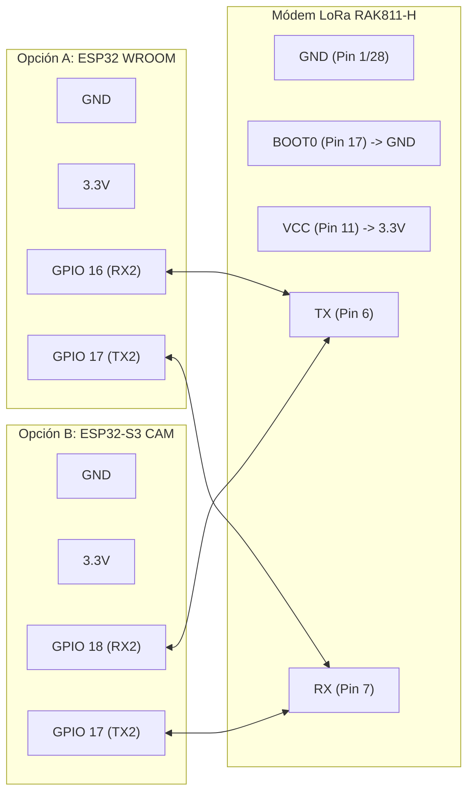
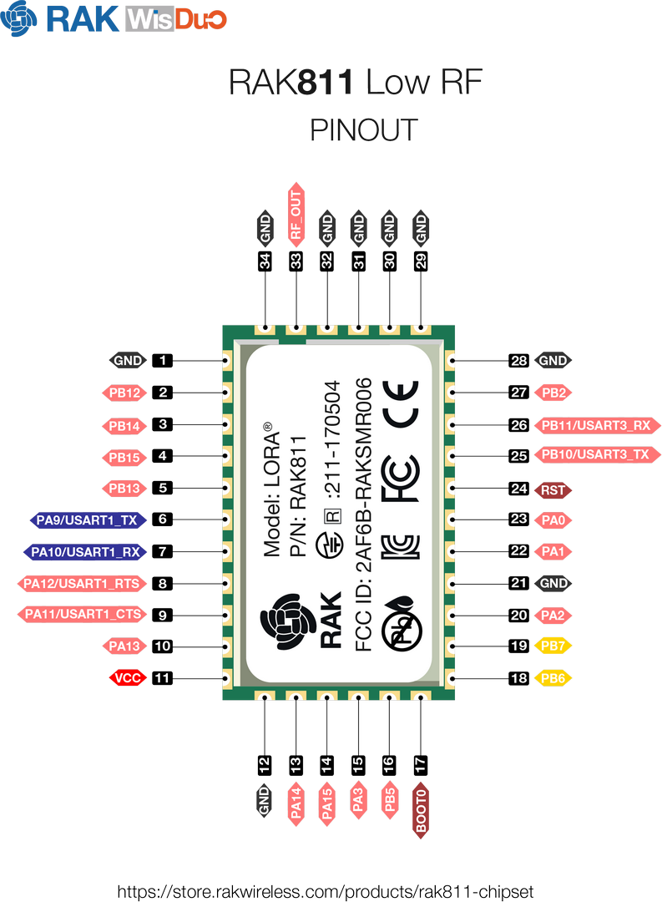
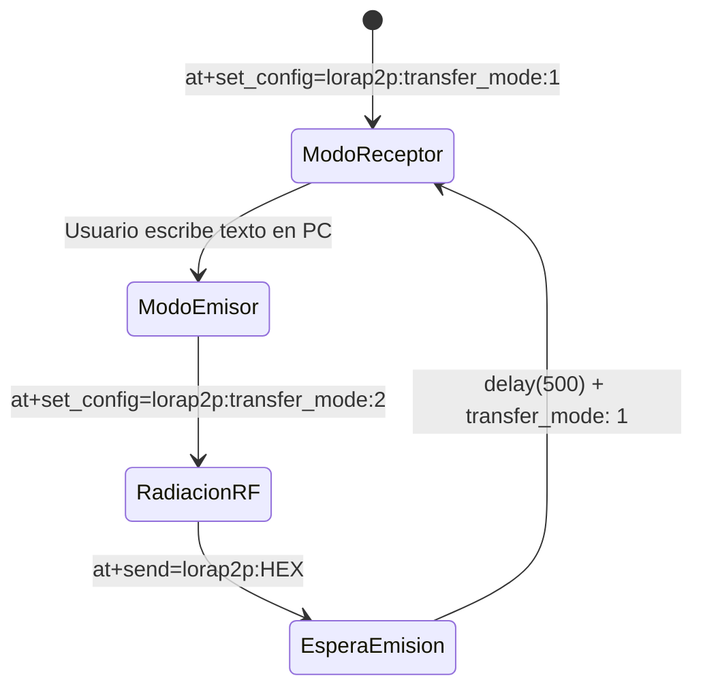
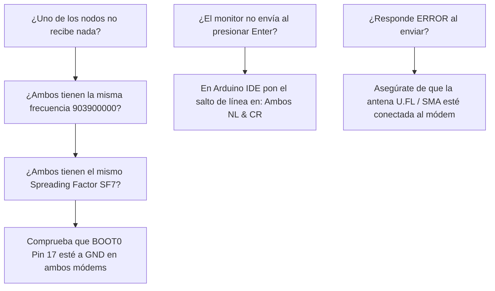

# 📡 MANUAL DE PRESENTACIÓN: COMUNICACIÓN BIDIRECCIONAL LORA P2P
> **Enlace de Radiofrecuencia Punto a Punto (903.9 MHz) entre dos ESP32 con Módem RAK811**  
> *Código analizado:* [`prueba_lora_wan_bidirecional.ino`](../prueba_lora_wan_bidirecional.ino)

---

```
  ┌─────────────────────────────────────────────────────────────────────────────┐
  │                           ÍNDICE DE LA PRESENTACIÓN                         │
  ├─────────────────────────────────────────────────────────────────────────────┤
  │  SLIDE 01 │ Portada & Concepto de Comunicación LoRa P2P Pura                │
  │  SLIDE 02 │ Arquitectura de Hardware & Selector Dual (WROOM vs S3 CAM)      │
  │  SLIDE 03 │ Parámetros de Radiofrecuencia Unificados (903.9 MHz / SF7)      │
  │  SLIDE 04 │ Explicación Línea por Línea: Selector de Placa & Macros         │
  │  SLIDE 05 │ Explicación Línea por Línea: Conversión ASCII <-> HEX           │
  │  SLIDE 06 │ Explicación Línea por Línea: Gestión de Comandos AT y Receptor  │
  │  SLIDE 07 │ Explicación Línea por Línea: Transmisión Dúplex por Software    │
  │  SLIDE 08 │ Explicación Línea por Línea: Desarme de Tramas 'at+recv='       │
  │  SLIDE 09 │ Explicación Línea por Línea: El Bucle loop() de Chat en Vivo    │
  │  SLIDE 10 │ Ejemplo de Sesión en Vivo: Consola Nodo A vs Consola Nodo B     │
  │  SLIDE 11 │ Medición de Calidad de Enlace: Telemetría RSSI & SNR            │
  │  SLIDE 12 │ Guía de Puesta en Marcha y Solución de Problemas                │
  └─────────────────────────────────────────────────────────────────────────────┘
```

---

<!-- SLIDE 01 -->
## 📻 SLIDE 01: Concepto de Comunicación LoRa P2P Pura

```
      [ NODO A: ESP32 ]                                    [ NODO B: ESP32 ]
    (WROOM o ESP32-S3 CAM)                               (WROOM o ESP32-S3 CAM)
              │                                                     │
              ▼                                                     ▼
     ┌─────────────────┐       Ondas de Radio 903.9 MHz    ┌─────────────────┐
     │  Módem RAK811   │  <═════════════════════════════>  │  Módem RAK811   │
     │  (Transceptor)  │        Alcance: Varios Km         │  (Transceptor)  │
     └─────────────────┘                                   └─────────────────┘
              ▲                                                     ▲
              │ (USB Serial)                                        │ (USB Serial)
      [ PC / CONSOLA A ]                                    [ PC / CONSOLA B ]
      "Hola desde Nodo A"                                   "Respuesta desde B"
```

### ¿Qué hace especial a este sketch?
* **Código Espejo Unificado:** El mismo archivo `.ino` se sube a **ambas placas**. No necesitas compilar programas diferentes para el emisor y el receptor.
* **Modo Chat Asíncrono:** Ambos nodos escuchan permanentemente la frecuencia de 903.9 MHz. Cuando cualquier usuario escribe en su computadora, la placa transmite el paquete al aire y regresa al instante a modo escucha para recibir la respuesta.
* **Sin pasarelas ni internet:** Es una red privada pura (**Peer-to-Peer**). Funciona en el campo, montaña o sótanos sin cobertura telefónica ni WiFi.

---

<!-- SLIDE 02 -->
## 🔌 SLIDE 02: Arquitectura de Hardware & Selector Dual



### 📸 Pinouts y Datasheets del Hardware

#### 1. Módulo LoRa RAK811-H


#### 2. Microcontroladores Compatibles en el Mismo Código
| ESP32 WROOM (38 Pines) | Freenove ESP32-S3 WROOM CAM |
| :---: | :---: |
|  |  |

---

### 📋 Tabla de Conexión según la Placa Seleccionada

| Señal | Pin RAK811 | Si usas ESP32 WROOM | Si usas ESP32-S3 CAM | Nota Eléctrica |
| :--- | :---: | :---: | :---: | :--- |
| **VCC** | Pin 11 | **3V3** | **3V3** | Alimentación lógica (3.3V). |
| **GND** | Pin 1 y 28 | **GND** | **GND** | Tierra común. |
| **BOOT0** | Pin 17 | **GND** | **GND** | **Obligatorio a GND** para arrancar en modo AT. |
| **TX del Módem** | Pin 6 | **GPIO 16 (RX2)** | **GPIO 18 (RX2)** | Entrada de datos al microcontrolador. |
| **RX del Módem** | Pin 7 | **GPIO 17 (TX2)** | **GPIO 17 (TX2)** | Salida de comandos desde el microcontrolador. |

---

<!-- SLIDE 03 -->
## 📻 SLIDE 03: Parámetros de Radiofrecuencia Unificados

Para que dos radios LoRa puedan comunicarse, **todos sus parámetros de capa física (PHY) deben ser matemáticamente idénticos**:

```cpp
#define LORA_P2P_CONFIG "903900000:7:0:1:8:5"
```

```
     903900000   :   7   :   0   :   1   :   8   :   5
         │           │       │       │       │       │
         │           │       │       │       │       └─> Potencia: 5 dBm (ideal para mesa)
         │           │       │       │       └─────────> Preámbulo: 8 símbolos
         │           │       │       └─────────────────> Coding Rate: 1 (4/5)
         │           │       └─────────────────────────> Ancho de Banda: 0 (125 kHz)
         │           └─────────────────────────────────> Spreading Factor: SF7
         └─────────────────────────────────────────────> Frecuencia Central: 903.9 MHz
```

### Significado de cada Parámetro:
* **Frecuencia (903.9 MHz):** Canal central en la banda ISM de 902-928 MHz autorizada en América Latina y EE.UU.
* **Spreading Factor (SF7):** Modulación de ensanchamiento de espectro por chirp. SF7 ofrece la tasa de datos más rápida y menor consumo energético.
* **Bandwidth (125 kHz):** Ancho del canal de radio estándar para equilibrio óptimo entre sensibilidad y velocidad.
* **Coding Rate (4/5):** Añade 1 bit de redundancia por cada 4 bits de datos para corregir errores por interferencias atmosféricas.

---

<!-- SLIDE 04 -->
## 💻 SLIDE 04: Explicación Línea por Línea: Selector de Placa

En las líneas 23 a 43 de [`prueba_lora_wan_bidirecional.ino`](../prueba_lora_wan_bidirecional.ino):

```cpp
// =========================================================================
// SELECCIÓN DE PLACA (Descomenta la que corresponda a este ESP32)
// =========================================================================
// Opción A: ESP32 WROOM estándar (38 o 30 pines)
//#define ES_ESP32_WROOM

// Opción B: ESP32-S3 CAM (Descomenta esta línea si vas a subirlo al S3 CAM)
#define ES_ESP32_S3_CAM

#if defined(ES_ESP32_S3_CAM)
  #define NOMBRE_NODO  "NODO_S3_CAM"
  #define RAK_RX_PIN   18  // Al TX del RAK811 (Pin 6)
  #define RAK_TX_PIN   17  // Al RX del RAK811 (Pin 7)
#else
  #define NOMBRE_NODO  "NODO_WROOM"
  #define RAK_RX_PIN   16  // Al TX del RAK811 (Pin 6)
  #define RAK_TX_PIN   17  // Al RX del RAK811 (Pin 7)
#endif

#define RAK_BAUD     115200
HardwareSerial LoRaSerial(2);
```

### ¿Por qué este diseño es inteligente?
* Permite grabar una placa como `NODO_S3_CAM` y la otra como `NODO_WROOM` simplemente descomentando una línea antes de subir el programa.
* Asigna automáticamente el pin `18` para el S3 CAM (evitando interferir con el bus de la cámara OV2640) o el pin `16` para el WROOM tradicional.
* Utiliza el segundo puerto serie por hardware del ESP32 (`UART2`), dejando el puerto USB libre para el Monitor Serie.

---

<!-- SLIDE 05 -->
## 🔠 SLIDE 05: Explicación Línea por Línea: Conversión ASCII <-> HEX

El RAK811 en modo LoRa P2P **exige que el contenido a transmitir esté codificado en formato Hexadecimal**:

```cpp
// Convierte texto legible ("Hola") a cadena HEX ("486F6C61")
String stringToHex(const String& input) {
  String hexStr = "";
  for (unsigned int i = 0; i < input.length(); i++) {
    char buf[3];
    sprintf(buf, "%02X", (unsigned char)input[i]);
    hexStr += buf;
  }
  return hexStr;
}

// Convierte cadena HEX ("486F6C61") a texto legible ("Hola")
String hexToString(const String& hex) {
  String text = "";
  for (unsigned int i = 0; i < hex.length(); i += 2) {
    if (i + 1 < hex.length()) {
      char byteChars[3] = { hex[i], hex[i + 1], '\0' };
      char c = (char)strtol(byteChars, NULL, 16);
      text += c;
    }
  }
  return text;
}
```

```
  Entrada del Usuario :   'H'        'o'        'l'        'a'
  Código Decimal      :    72        111        108         97
  Representación HEX  :   0x48       0x6F       0x6C       0x61
  Comando enviado     :   at+send=lorap2p:486F6C61\r\n
```

---

<!-- SLIDE 06 -->
## ⚙️ SLIDE 06: Explicación Línea por Línea: Comandos AT y Modo Escucha

```cpp
// Envía un comando AT esperando respuesta OK o ERROR con ventana de timeout
bool enviarComandoAT(const String& cmd, uint32_t timeoutMs = 1500) {
  while (LoRaSerial.available()) LoRaSerial.read(); // Limpiar residuos
  LoRaSerial.printf("%s\r\n", cmd.c_str());

  unsigned long start = millis();
  String resp = "";
  while (millis() - start < timeoutMs) {
    while (LoRaSerial.available()) {
      resp += (char)LoRaSerial.read();
    }
    if (resp.indexOf("OK") != -1) return true;
    if (resp.indexOf("ERROR") != -1) return false;
    delay(10);
  }
  return false;
}

// Pone al RAK811 en modo Escucha permanente (Receiver Mode = 1)
void activarModoRecepcion() {
  LoRaSerial.print("at+set_config=lorap2p:transfer_mode:1\r\n");
  delay(100);
  while (LoRaSerial.available()) LoRaSerial.read();
}
```

> [!IMPORTANT]
> `transfer_mode: 1` le indica al módem Semtech que active el amplificador de bajo ruido (LNA) del receptor y escuche el éter permanentemente en busca del preámbulo de radiofrecuencia.

---

<!-- SLIDE 07 -->
## 🚀 SLIDE 07: Explicación Línea por Línea: Transmisión Dúplex



```cpp
void enviarMensajeLoRa(String mensaje) {
  mensaje.trim();
  if (mensaje.length() == 0) return;

  Serial.println();
  Serial.printf(">> [TRANSMITIENDO] \"%s\"\n", mensaje.c_str());

  // 1. Cambiar a modo Emisor (Sender Mode = 2)
  LoRaSerial.print("at+set_config=lorap2p:transfer_mode:2\r\n");
  delay(100);
  while (LoRaSerial.available()) LoRaSerial.read();

  // 2. Convertir texto a HEX y transmitir por radio
  String payloadHex = stringToHex(mensaje);
  LoRaSerial.printf("at+send=lorap2p:%s\r\n", payloadHex.c_str());

  // 3. Esperar 500 ms a que la radio termine de emitir todo el paquete
  delay(500);
  while (LoRaSerial.available()) LoRaSerial.read();

  // 4. Volver inmediatamente a modo Escucha (Receiver Mode = 1)
  activarModoRecepcion();

  Serial.println(">> [ENVIADO] Paquete emitido al aire. Escuchando respuestas...");
}
```

---

<!-- SLIDE 08 -->
## 📥 SLIDE 08: Explicación Línea por Línea: Desarme de Tramas

Cuando la radio recibe un paquete, el RAK811 envía automáticamente una línea por UART:

```
at+recv=-62,9,4:486F6C61
         │  │ │    │
         │  │ │    └─> Datos HEX ("486F6C61" = "Hola")
         │  │ └──────> Longitud: 4 bytes
         │  └────────> SNR: 9 dB
         └───────────> RSSI: -62 dBm
```

### Código de Desarme en `procesarPaqueteRecibido`:
```cpp
void procesarPaqueteRecibido(String raw) {
  int dosPuntos = raw.indexOf(':');
  if (dosPuntos == -1) return;

  // Extraer metadatos
  String meta = raw.substring(8, dosPuntos); // "-62,9,4"
  String hexData = raw.substring(dosPuntos + 1); // "486F6C61"
  hexData.trim();

  int coma1 = meta.indexOf(',');
  int coma2 = meta.indexOf(',', coma1 + 1);
  String rssi = (coma1 != -1) ? meta.substring(0, coma1) : "?";
  String snr  = (coma1 != -1 && coma2 != -1) ? meta.substring(coma1 + 1, coma2) : "?";
  String len  = (coma2 != -1) ? meta.substring(coma2 + 1) : "?";

  // Convertir HEX a texto legible
  String texto = hexToString(hexData);

  Serial.println("**************************************************");
  Serial.println("       >>> [MENSAJE RECIBIDO POR LORA] <<<        ");
  Serial.println("**************************************************");
  Serial.printf("  Texto Recibido : %s\n", texto.c_str());
  Serial.printf("  Intensidad RSSI: %s dBm\n", rssi.c_str());
  Serial.printf("  Calidad SNR    : %s dB\n", snr.c_str());
  Serial.printf("  Tamaño         : %s bytes\n", len.c_str());
  Serial.println("**************************************************\n");
}
```

---

<!-- SLIDE 09 -->
## 🔄 SLIDE 09: El Bucle `loop()` de Chat en Vivo

```cpp
void loop() {
  // 1. RECEPCIÓN: Revisar si el RAK811 nos envió datos recibidos por radio
  if (LoRaSerial.available()) {
    String linea = LoRaSerial.readStringUntil('\n');
    linea.trim();
    if (linea.length() > 0) {
      if (linea.startsWith("at+recv=")) {
        procesarPaqueteRecibido(linea);
      } else if (linea != "OK") {
        Serial.printf("[MODEM]: %s\n", linea.c_str());
      }
    }
  }

  // 2. TRANSMISIÓN: Revisar si escribiste algo en la PC para enviarlo
  if (Serial.available()) {
    String entrada = Serial.readStringUntil('\n');
    entrada.trim();
    if (entrada.length() > 0) {
      // Si el usuario escribe un comando AT directo (ej: at+version), pasa directo
      if (entrada.startsWith("at+") || entrada.startsWith("AT+")) {
        LoRaSerial.printf("%s\r\n", entrada.c_str());
      } else {
        // Si escribe un texto normal, lo enviamos por LoRa P2P
        enviarMensajeLoRa(entrada);
      }
    }
  }
}
```

---

<!-- SLIDE 10 -->
## 💬 SLIDE 10: Ejemplo de Sesión de Chat en Vivo

```
  =============================================      =============================================
             CONSOLA A (ESP32 WROOM)                            CONSOLA B (ESP32-S3 CAM)
  =============================================      =============================================
  >> [TRANSMITIENDO] "Hola Nodo B, ¿me copias?"      **************************************************
  >> [ENVIADO] Paquete emitido al aire...                  >>> [MENSAJE RECIBIDO POR LORA] <<<        
                                                     **************************************************
                                                       Texto Recibido : Hola Nodo B, ¿me copias?
                                                       Intensidad RSSI: -58 dBm
                                                       Calidad SNR    : 8 dB
                                                     **************************************************
                                                     >> [TRANSMITIENDO] "Fuerte y claro Nodo A, 10-4"
  ************************************************** >> [ENVIADO] Paquete emitido al aire...
        >>> [MENSAJE RECIBIDO POR LORA] <<<        
  **************************************************
    Texto Recibido : Fuerte y claro Nodo A, 10-4
    Intensidad RSSI: -57 dBm
    Calidad SNR    : 9 dB
  **************************************************
```

---

<!-- SLIDE 11 -->
## 📊 SLIDE 11: Medición de Calidad de Enlace: RSSI & SNR

En cada paquete recibido, la pantalla te muestra la salud de la señal de radiofrecuencia:

```
  Potencia Recibida (RSSI en dBm):
  -30 dBm ════════════════════════════ -70 dBm ════════════════════════════ -120 dBm
  [ Extremadamente Cerca ]         [ Señal Ideal / Normal ]       [ Límite de Pérdida ]

  Relación Señal/Ruido (SNR en dB):
  +10 dB ──────────────────────────── 0 dB ──────────────────────────── -15 dB
  [ Señal muy limpia ]             [ Señal = Ruido ]              [ LoRa decodifica bajo ruido ]
```

### La Magia de LoRa:
A diferencia de WiFi o Bluetooth que se cortan cuando la señal cae por debajo del nivel de ruido ($SNR \le 0\text{ dB}$), **LoRa puede decodificar paquetes con SNR de hasta $-20\text{ dB}$**, es decir, extrayendo datos matemáticamente aunque la señal esté enterrada bajo el ruido ambiental.

---

<!-- SLIDE 12 -->
## 🛠️ SLIDE 12: Guía de Puesta en Marcha y Troubleshooting



### Configuración del Monitor Serie en Arduino IDE:
* **Velocidad:** `115200 baudios`.
* **Fin de línea:** `Ambos NL y CR` (Both NL & CR).

---
> 💡 *Manual generado y almacenado en:* `MANUALES/PRESENTACION_LORA_BIDIRECCIONAL_PURO.md`
