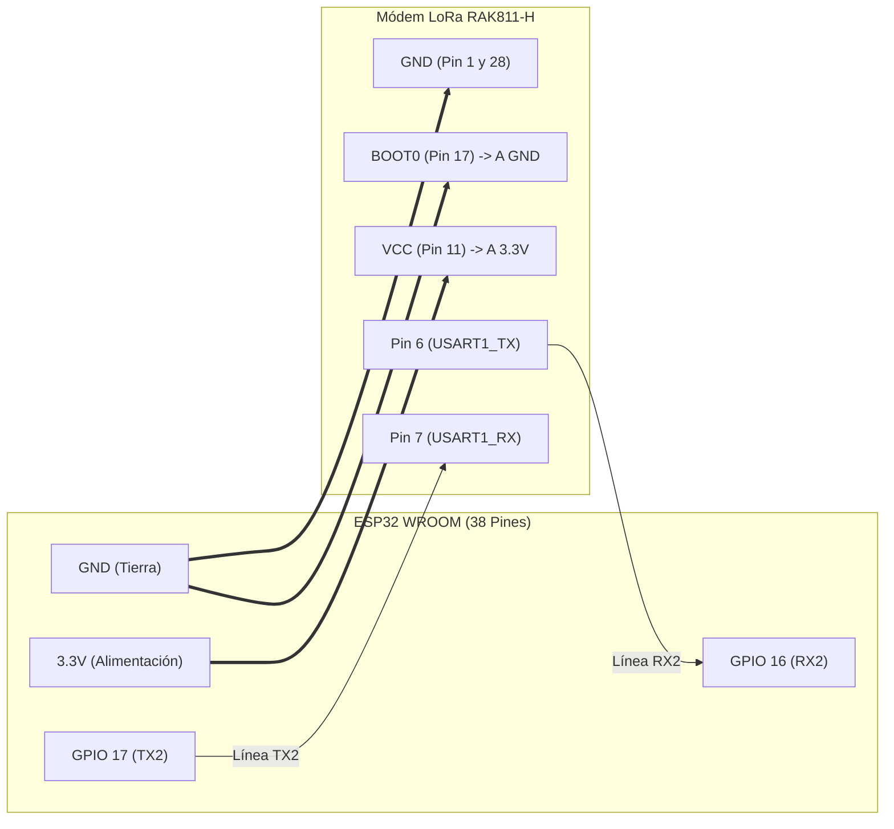
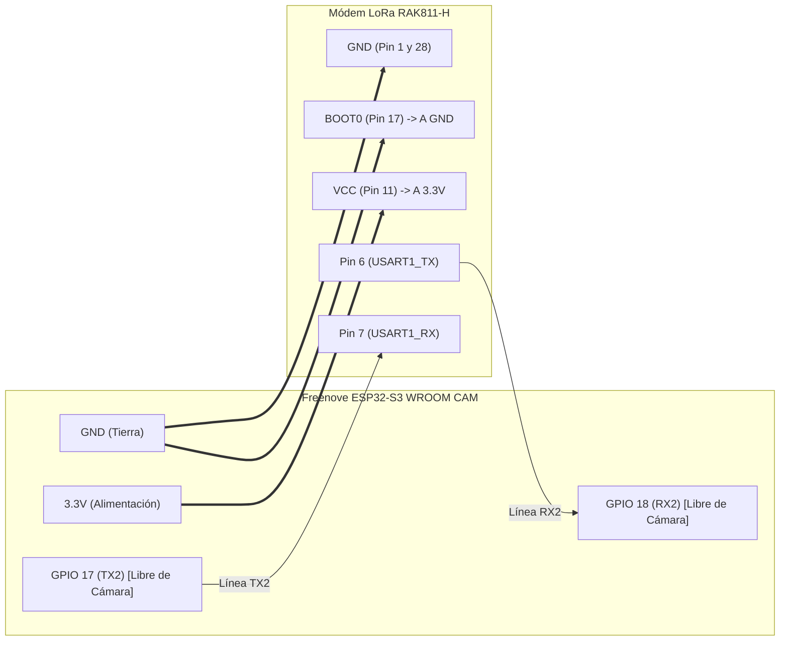
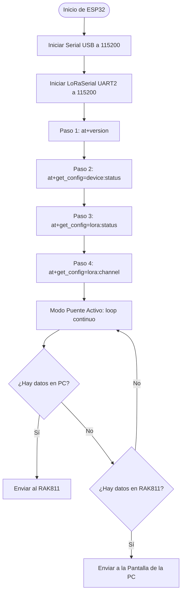
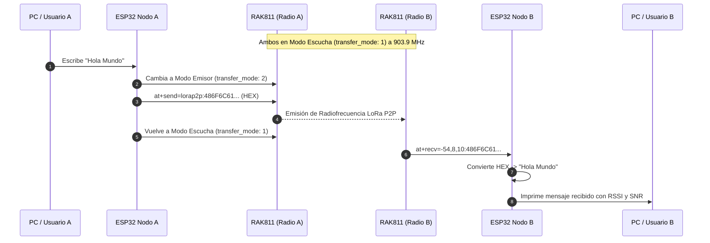
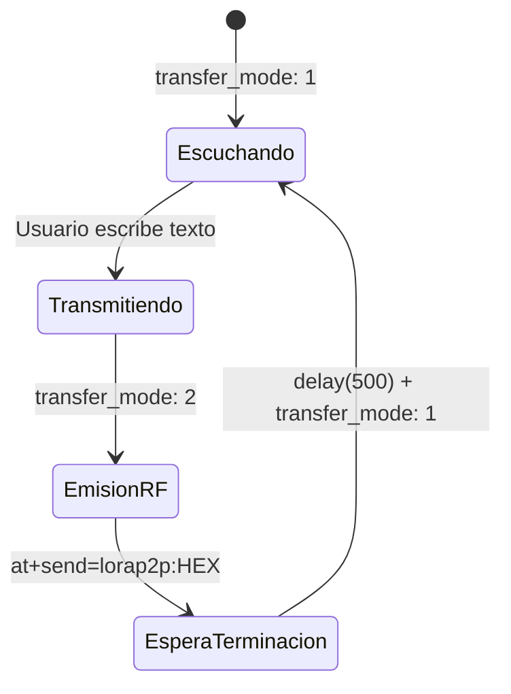
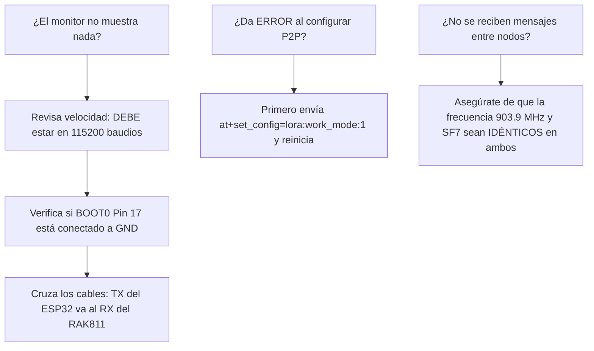

# 📡 MANUAL DE PRESENTACIÓN: MÓDULOS LORA RAK811 + ESP32
> **Arquitectura, Diagnóstico y Comunicación P2P Bidireccional en Radiofrecuencia (903.9 MHz)**  
> *Códigos analizados:* [`prueba_lora_wan.ino`](../prueba_lora_wan.ino) & [`prueba_lora_wan_bidirecional.ino`](../prueba_lora_wan_bidirecional.ino)

---

```
  ┌─────────────────────────────────────────────────────────────────────────────┐
  │                           ÍNDICE DE LA PRESENTACIÓN                         │
  ├─────────────────────────────────────────────────────────────────────────────┤
  │  SLIDE 01 │ Portada & Visión General del Sistema LoRa                        │
  │  SLIDE 02 │ Arquitectura de Hardware & Pinout de Conexión                   │
  │  SLIDE 03 │ Código 1: "prueba_lora_wan.ino" - Diagnóstico y Modo Puente     │
  │  SLIDE 04 │ Explicación Línea por Línea: "ejecutarComando" y Buffer UART    │
  │  SLIDE 05 │ Explicación Línea por Línea: Setup Diagnóstico y Loop Puente     │
  │  SLIDE 06 │ Código 2: "prueba_lora_wan_bidirecional.ino" - Red LoRa P2P     │
  │  SLIDE 07 │ Explicación Línea por Línea: Conversión ASCII <-> HEX           │
  │  SLIDE 08 │ Explicación Línea por Línea: Transmisión y Alternancia de Modo  │
  │  SLIDE 09 │ Explicación Línea por Línea: Decodificación de Tramas & RSSI/SNR│
  │  SLIDE 10 │ Matriz Comparativa: Diagnóstico vs Bidireccional P2P            │
  │  SLIDE 11 │ Guía de Comandos AT y Solución de Problemas (Troubleshooting)   │
  │  SLIDE 12 │ Conclusiones y Paso hacia el Control por Voz + LEDs             │
  └─────────────────────────────────────────────────────────────────────────────┘
```

---

<!-- SLIDE 01 -->
## 🖥️ SLIDE 01: Visión General del Sistema LoRa

```
               [ COMPUTADORA / MONITOR SERIE ]
                             │  (USB Serial @ 115200)
                             ▼
                ┌─────────────────────────┐
                │   ESP32 (WROOM / S3)    │
                │     Cerebro / Host      │
                └────────────┬────────────┘
                             │  (UART2 @ 115200)
                             ▼
                ┌─────────────────────────┐
                │   RAK811-H LoRa MODEM   │
                │  Transceptor Semtech    │
                └────────────┬────────────┘
                             │  (Ondas de Radio 903.9 MHz)
                             ▼
                      ((( 📡 ANTENA )))
```

### ¿Cuál es el objetivo de estos dos códigos?

1. **[`prueba_lora_wan.ino`](../prueba_lora_wan.ino) (El Escáner & Puente Diagnóstico):**
   * Es la herramienta de **puesta en marcha**.
   * Interroga al chip RAK811 sobre su salud interna: versión de firmware, canales de radio activos, llaves DevEUI y estado del hardware.
   * Abre una **pasarela transparente (Bridge)**: todo lo que escribes en la PC viaja directo al módem y viceversa.

2. **[`prueba_lora_wan_bidirecional.ino`](../prueba_lora_wan_bidirecional.ino) (La Red de Datos P2P):**
   * Convierte a dos ESP32 en **compañeros de chat por radio punto a punto**.
   * Sin necesidad de antenas repetidoras ni pasarelas Gateway LoRaWAN comerciales.
   * Maneja el protocolo de escucha permanente y transmisión instantánea con telemetría en tiempo real (**RSSI** y **SNR**).

---

<!-- SLIDE 02 -->
## 🔌 SLIDE 02: Arquitectura de Hardware & Pinout

```
  ┌─────────────────────────────────────────────────────────────────────────────┐
  │         ¿POR QUÉ LAS CONEXIONES SON DIFERENTES EN CADA PLACA?               │
  ├─────────────────────────────────────────────────────────────────────────────┤
  │ * ESP32 WROOM : Usa GPIO 16 (RX2) y GPIO 17 (TX2) por defecto.              │
  │ * ESP32-S3 CAM: GPIO 16 está ocupado por la cámara (CAM_Y9). Para evitar   │
  │                 conflictos, se reasigna a GPIO 18 (RX2) y GPIO 17 (TX2).   │
  └─────────────────────────────────────────────────────────────────────────────┘
```

### 🔹 CASO A: Conexión ESP32 WROOM <---> Módem LoRa RAK811



#### 📸 Pinout ESP32 WROOM


#### 📋 Tabla de Conexión: ESP32 WROOM
| Señal | Pin RAK811-H | Pin ESP32 WROOM | Función Eléctrica |
| :--- | :---: | :---: | :--- |
| **VCC** | Pin 11 | **3V3** | Alimentación lógica (3.3V estrictos). |
| **GND** | Pin 1 y 28 | **GND** | Masa o tierra de referencia común. |
| **BOOT0** | Pin 17 | **GND** | **Forzado a GND** para arrancar en modo comandos AT. |
| **TX (Módem)** | Pin 6 | **GPIO 16 (RX2)** | El módem transmite datos hacia el ESP32 WROOM. |
| **RX (Módem)** | Pin 7 | **GPIO 17 (TX2)** | El ESP32 WROOM envía comandos hacia el módem. |

---

### 🔸 CASO B: Conexión ESP32-S3 CAM <---> Módem LoRa RAK811



#### 📸 Pinout Freenove ESP32-S3 WROOM CAM


#### 📋 Tabla de Conexión: ESP32-S3 CAM
| Señal | Pin RAK811-H | Pin ESP32-S3 CAM | Función Eléctrica |
| :--- | :---: | :---: | :--- |
| **VCC** | Pin 11 | **3V3** | Alimentación lógica (3.3V estrictos). |
| **GND** | Pin 1 y 28 | **GND** | Masa o tierra de referencia común. |
| **BOOT0** | Pin 17 | **GND** | **Forzado a GND** para arrancar en modo comandos AT. |
| **TX (Módem)** | Pin 6 | **GPIO 18 (RX2)** | El módem transmite datos hacia el ESP32-S3 CAM. |
| **RX (Módem)** | Pin 7 | **GPIO 17 (TX2)** | El ESP32-S3 CAM envía comandos hacia el módem. |

---

### 📸 Pinout del Módem LoRaWAN RAK811-H (Común para Ambos Casos)


> [!WARNING]
> En cualquiera de las dos placas, el pin **BOOT0 (Pin 17)** del RAK811 debe estar **siempre soldado o conectado a GND**. Si queda flotando, el módem entrará al cargador de firmware (Bootloader) y no responderá a ningún comando.

---

<!-- SLIDE 03 -->
## 🛠️ SLIDE 03: Código 1 - `prueba_lora_wan.ino` (Diagnóstico)



### ¿Por qué existe este código?
Antes de poner dos radios a hablar, necesitas asegurarte de que:
* El chip RAK811 no está dañado ni quemado.
* El cableado RX/TX está cruzado correctamente.
* La velocidad en baudios es exactamente **115200**.
* El firmware responde `"OK"`.

---

<!-- SLIDE 04 -->
## 🔍 SLIDE 04: Desglose Línea por Línea (`prueba_lora_wan.ino`)

### Parte A: La Función `ejecutarComando()`

```cpp
void ejecutarComando(const char* titulo, const char* comando, uint32_t timeoutMs = 2000) {
  // 1. Limpieza de basura en el búfer serie
  while (LoRaSerial.available()) {
    LoRaSerial.read();
  }

  // 2. Transmisión del comando AT con terminadores CRLF (\r\n)
  LoRaSerial.printf("%s\r\n", comando);

  unsigned long inicio = millis();
  String respuesta = "";
  
  // 3. Espera no bloqueante con ventana de tiempo (Timeout)
  while (millis() - inicio < timeoutMs) {
    while (LoRaSerial.available()) {
      respuesta += (char)LoRaSerial.read();
    }
    // 4. Salida anticipada en cuanto el módem responde OK o ERROR
    if (respuesta.indexOf("OK") != -1 || respuesta.indexOf("ERROR") != -1) {
      delay(50);
      while (LoRaSerial.available()) respuesta += (char)LoRaSerial.read();
      break;
    }
    delay(10);
  }
}
```

#### 📌 ¿Qué hace cada bloque?
1. **Limpieza de Buffer:** Si el módem envió ruido o un mensaje previo, vaciamos la memoria con `LoRaSerial.read()` para que no contamine la respuesta nueva.
2. **`\r\n` Obligatorio:** Todos los módems AT exigen retorno de carro (`\r`) y salto de línea (`\n`). Si envías solo el texto, el módem se queda esperando indefinidamente.
3. **Control de Timeout:** Si un cable se desconectó, el código no se congela para siempre; se rinde tras 2000 ms y continúa.
4. **Detección inteligente de fin de respuesta:** En cuanto detecta `"OK"` o `"ERROR"`, no espera los 2 segundos completos; sale de inmediato ganando velocidad.

---

<!-- SLIDE 05 -->
## 🔄 SLIDE 05: Setup Diagnóstico y Loop Puente

### Parte B: El Setup de Auditoría

```cpp
void setup() {
  Serial.begin(115200);
  LoRaSerial.begin(RAK_BAUD, SERIAL_8N1, RAK_RX_PIN, RAK_TX_PIN);

  // Comandos de diagnóstico ejecutados en secuencia:
  ejecutarComando("1. VERSION DE FIRMWARE", "at+version", 1500);
  ejecutarComando("2. ESTADO DEL DISPOSITIVO", "at+get_config=device:status", 2000);
  ejecutarComando("3. CONFIGURACION LORAWAN", "at+get_config=lora:status", 2500);
  ejecutarComando("4. CANALES Y FRECUENCIAS", "at+get_config=lora:channel", 2000);
}
```

### Parte C: El Bucle `loop()` - Puente Transparente (Bridge)

```cpp
void loop() {
  // Si el módem LoRa habla -> Lo mostramos en el Monitor de la PC
  if (LoRaSerial.available()) {
    Serial.write(LoRaSerial.read());
  }

  // Si escribes algo en el Monitor de la PC -> Se lo inyectamos al módem LoRa
  if (Serial.available()) {
    LoRaSerial.write(Serial.read());
  }
}
```

> [!TIP]
> **¿Por qué este `loop()` es tan potente?**  
> Convierte tu ESP32 en un adaptador USB-a-Serial directo hacia el RAK811. Puedes abrir la consola y escribir comandos manuales como `at+help` o `at+version` sin reprogramar la placa.

---

<!-- SLIDE 06 -->
## 📻 SLIDE 06: Código 2 - `prueba_lora_wan_bidirecional.ino` (Red P2P)



### Configuración de Radiofrecuencia Unificada
Ambos nodos utilizan la constante compartida:
```cpp
#define LORA_P2P_CONFIG "903900000:7:0:1:8:5"
```
* **`903900000`**: Frecuencia 903.9 MHz (Banda ISM libre de América).
* **`7`**: Spreading Factor (SF7 = balance ideal entre alcance y velocidad).
* **`0`**: Ancho de banda (Bandwidth 0 = 125 kHz).
* **`1`**: Tasa de codificación (Coding Rate 4/5 para corrección de errores).
* **`8`**: Longitud de preámbulo (8 símbolos).
* **`5`**: Potencia de transmisión (+5 dBm, potencia segura para pruebas de escritorio).

---

<!-- SLIDE 07 -->
## 🔠 SLIDE 07: Desglose: Conversión de Datos (ASCII <-> HEX)

El firmware del RAK811 en modo P2P **no acepta texto directo**; exige cadenas codificadas en **Hexadecimal**.

```
  Texto legible:       H       o       l       a
  Código ASCII:       72     111     108      97
  Representación HEX: 48      6F      6C      61
  Payload final:     "486F6C61"
```

### Funciones en el Código

```cpp
// 1. Convertir "Hola" -> "486F6C61"
String stringToHex(const String& input) {
  String hexStr = "";
  for (unsigned int i = 0; i < input.length(); i++) {
    char buf[3];
    sprintf(buf, "%02X", (unsigned char)input[i]);
    hexStr += buf;
  }
  return hexStr;
}

// 2. Convertir "486F6C61" -> "Hola"
String hexToString(const String& hex) {
  String text = "";
  for (unsigned int i = 0; i < hex.length(); i += 2) {
    if (i + 1 < hex.length()) {
      char byteChars[3] = { hex[i], hex[i + 1], '\0' };
      char c = (char)strtol(byteChars, NULL, 16);
      text += c;
    }
  }
  return text;
}
```

> [!NOTE]
> `strtol(byteChars, NULL, 16)` toma pares de 2 caracteres hexadecimales (ej. `"48"`) y los interpreta en base 16 para reconstruir el carácter original `'H'`.

---

<!-- SLIDE 08 -->
## 🚀 SLIDE 08: Transmisión y Alternancia de Modo (`enviarMensajeLoRa`)

Un radio LoRa half-duplex **no puede transmitir y recibir al mismo tiempo con una sola antena**.  
Por eso, el código implementa una máquina de estados:



### Código de Transmisión:
```cpp
void enviarMensajeLoRa(String mensaje) {
  mensaje.trim();
  if (mensaje.length() == 0) return;

  // PASO 1: Cambiar a modo Emisor (Sender Mode = 2)
  LoRaSerial.print("at+set_config=lorap2p:transfer_mode:2\r\n");
  delay(100);
  while (LoRaSerial.available()) LoRaSerial.read();

  // PASO 2: Convertir a HEX y transmitir por antena
  String payloadHex = stringToHex(mensaje);
  LoRaSerial.printf("at+send=lorap2p:%s\r\n", payloadHex.c_str());

  // PASO 3: Esperar que el paquete termine de salir al aire
  delay(500);
  while (LoRaSerial.available()) LoRaSerial.read();

  // PASO 4: Regresar a modo Escucha permanente (Receiver Mode = 1)
  activarModoRecepcion();
}
```

---

<!-- SLIDE 09 -->
## 📥 SLIDE 09: Recepción y Decodificación de Tramas

Cuando la radio receptora detecta una señal en el aire, el RAK811 escupe por UART una trama con este formato estricto:

```
at+recv=-65,9,4:554E4F
         │  │ │    │
         │  │ │    └─> Payload HEX recibido ("554E4F" = "UNO")
         │  │ └──────> Longitud: 4 bytes
         │  └────────> SNR: 9 dB (Relación Señal/Ruido)
         └───────────> RSSI: -65 dBm (Intensidad de la señal recibida)
```

### Desarme en el Código (`procesarPaqueteRecibido`):
```cpp
void procesarPaqueteRecibido(String raw) {
  int dosPuntos = raw.indexOf(':');
  
  // 1. Extraer metadatos antes de los ':'
  String meta = raw.substring(8, dosPuntos); // "-65,9,4"
  String hexData = raw.substring(dosPuntos + 1); // "554E4F"

  // 2. Extraer RSSI y SNR separando por comas
  int coma1 = meta.indexOf(',');
  int coma2 = meta.indexOf(',', coma1 + 1);
  String rssi = meta.substring(0, coma1);
  String snr  = meta.substring(coma1 + 1, coma2);

  // 3. Traducir datos a texto legible
  String texto = hexToString(hexData);

  // 4. Mostrar al usuario
  Serial.printf("  Texto Recibido : %s\n", texto.c_str());
  Serial.printf("  Intensidad RSSI: %s dBm\n", rssi.c_str());
  Serial.printf("  Calidad SNR    : %s dB\n", snr.c_str());
}
```

#### 📊 ¿Cómo interpretar la señal RF?
* **RSSI (dBm):** Mide la potencia recibida.
  * `-30 a -60 dBm`: Señal excelente (placa al lado de la otra).
  * `-70 a -95 dBm`: Señal buena en interiores / distancia media.
  * `-110 a -125 dBm`: Señal al límite de pérdida por distancia o muros.
* **SNR (dB):** Calidad de la señal sobre el ruido de fondo. Valores positivos ($>0\text{ dB}$) indican señal limpia.

---

<!-- SLIDE 10 -->
## ⚖️ SLIDE 10: Matriz Comparativa de Ambos Códigos

| Característica | [`prueba_lora_wan.ino`](../prueba_lora_wan.ino) | [`prueba_lora_wan_bidirecional.ino`](../prueba_lora_wan_bidirecional.ino) |
| :--- | :---: | :---: |
| **Objetivo Principal** | Diagnóstico y Configuración | Enlace de datos P2P activo |
| **Topología** | Nodo individual hacia PC | Dos o más nodos comunicándose |
| **Protocolo** | Comandos AT directos | LoRa P2P Propietario (903.9 MHz) |
| **Codificación** | Texto puro ASCII | Conversión bidireccional HEX |
| **Modo de Radio** | Configuración LoRaWAN estándar | Alternancia rápida `transfer_mode` 1 / 2 |
| **Manejo de Errores** | Timeout y lectura de `OK`/`ERROR` | Re-enganche a modo escucha automático |
| **Telemetría RF** | Consulta de canal por comando | Reporte en vivo de **RSSI** y **SNR** |

---

<!-- SLIDE 11 -->
## 🚨 SLIDE 11: Guía de Comandos AT y Troubleshooting

```
  ┌─────────────────────────────────────────────────────────────────────────────┐
  │                   COMANDOS AT MÁS ÚTILES PARA EL MONITOR                    │
  ├──────────────────────────────────┬──────────────────────────────────────────┤
  │ COMANDO                          │ ACCIÓN QUE REALIZA                       │
  ├──────────────────────────────────┼──────────────────────────────────────────┤
  │ at+version                       │ Devuelve la versión de firmware RAK811   │
  │ at+get_config=device:status      │ Batería, voltaje y estado de periféricos │
  │ at+set_config=lora:work_mode:1   │ Cambia de LoRaWAN a modo LoRa P2P       │
  │ at+set_config=lorap2p:transfer_mode:1 │ Pone el radio en escucha permanente │
  │ at+set_config=device:restart     │ Reinicia el módem RAK811 por software    │
  └──────────────────────────────────┴──────────────────────────────────────────┘
```

### Diagnóstico de Problemas Típicos:



---

<!-- SLIDE 12 -->
## 🏆 SLIDE 12: Conclusiones y Próximos Pasos

```
                   ┌──────────────────────────────────────┐
                   │           SISTEMA COMPLETO           │
                   └──────────────────┬───────────────────┘
                                      │
              ┌───────────────────────┴───────────────────────┐
              ▼                                               ▼
   ┌───────────────────────┐                       ┌───────────────────────┐
   │     ESP32 WROOM       │                       │     ESP32-S3 CAM      │
   │  Micrófono INMP441    │   ((( 903.9 MHz )))   │  Receptor LoRa P2P    │
   │   TinyML / Voz        │ ────────────────────> │  LED RGB Ánodo Común  │
   │   "UNO" / "DOS"       │ <──────────────────── │   GPIO 21 y GPIO 47   │
   │  Emisor LoRa P2P      │      (ACK Conf.)      │   Encendido/Apagado   │
   └───────────────────────┘                       └───────────────────────┘
```

### Logros Implementados:
1. **Comprobación de Capa Física:** Verificada con [`prueba_lora_wan.ino`](../prueba_lora_wan.ino).
2. **Capa de Enlace de Radio:** Dominada con [`prueba_lora_wan_bidirecional.ino`](../prueba_lora_wan_bidirecional.ino).
3. **Capa de Aplicación Final:**
   * **Nodo Emisor:** [`prueba_lora_wan_bidirecional_wroom.ino`](../prueba_lora_wan_bidirecional_wroom.ino) captura tu voz con el micrófono digital **INMP441** y dispara los paquetes LoRa al reconocer *"uno"* o *"dos"*.
   * **Nodo Receptor:** [`prueba_lora_wan_bidirecional_cam.ino`](../prueba_lora_wan_bidirecional_cam.ino) recibe el comando, conmuta los canales de tu **LED RGB de Ánodo Común** en los pines **GPIO 21 y GPIO 47**, y responde con un acuse de recibo (**ACK**).

---
> 💡 *Manual generado y almacenado en:* `MANUALES/PRESENTACION_LORA_ESP32.md`
