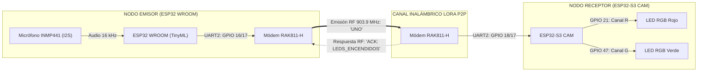
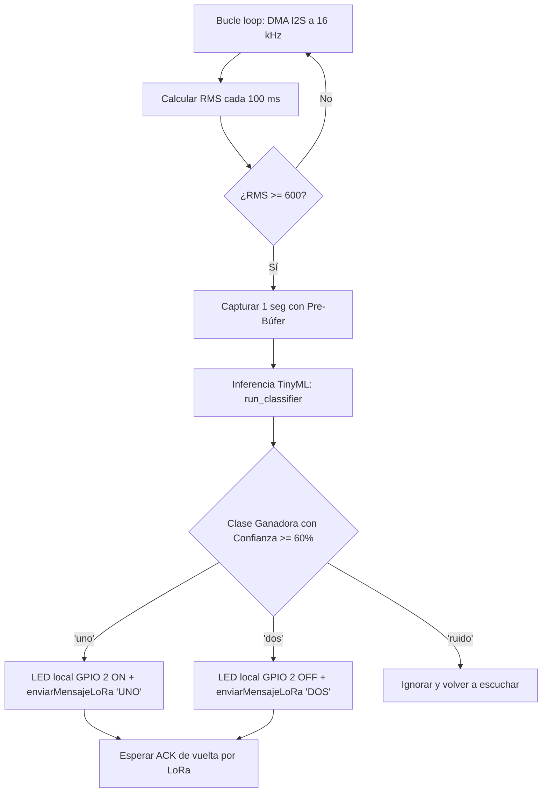
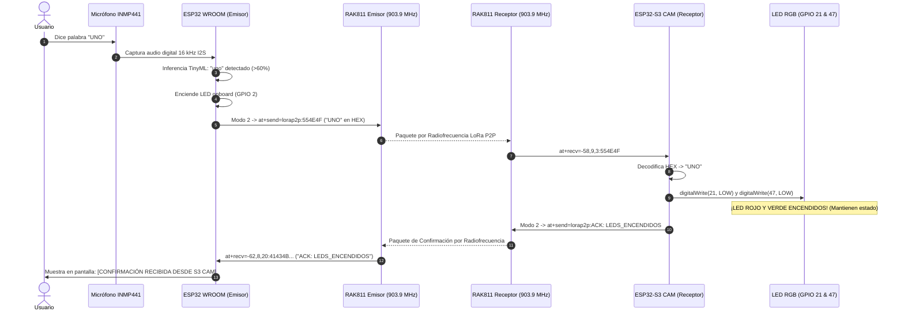

# 📡 MANUAL DE PRESENTACIÓN: SISTEMA LORA P2P BIDIRECCIONAL COMPLETO
> **Evolución del Código Base hacia Control por Voz (INMP441 + WROOM) y Actuación Remota (LEDs + S3 CAM)**  
> *Códigos analizados:* [`prueba_lora_wan_bidirecional.ino`](../prueba_lora_wan_bidirecional.ino), [`prueba_lora_wan_bidirecional_wroom.ino`](../prueba_lora_wan_bidirecional_wroom.ino) & [`prueba_lora_wan_bidirecional_cam.ino`](../prueba_lora_wan_bidirecional_cam.ino)

---

```
  ┌─────────────────────────────────────────────────────────────────────────────┐
  │                           ÍNDICE DE LA PRESENTACIÓN                         │
  ├─────────────────────────────────────────────────────────────────────────────┤
  │  SLIDE 01 │ Portada & Visión de la Red Distribuida LoRa                     │
  │  SLIDE 02 │ Arquitectura de Enlace Extremo a Extremo (Mermaid)              │
  │  SLIDE 03 │ Galería de Hardware & Pinouts Comparativos (WROOM vs S3 CAM)    │
  │  SLIDE 04 │ El Núcleo Base: "¿Cómo Funciona 'prueba_lora_wan_bidirecional'?"│
  │  SLIDE 05 │ Nodo Emisor: Adaptación WROOM + Micrófono INMP441 + TinyML      │
  │  SLIDE 06 │ Nodo Receptor: Adaptación S3 CAM + LED RGB Ánodo Común (21 & 47)│
  │  SLIDE 07 │ Matriz de Diferencias Técnicas (Código Base vs Adaptaciones)    │
  │  SLIDE 08 │ Diagrama de Secuencia del Protocolo de Radiofrecuencia (P2P)    │
  │  SLIDE 09 │ Telemetría y Monitores Seriales: ¿Qué se ve en cada Pantalla?   │
  │  SLIDE 10 │ Guía de Puesta en Marcha, Calibración y Pruebas Reales          │
  └─────────────────────────────────────────────────────────────────────────────┘
```

---

<!-- SLIDE 01 -->
## 🌐 SLIDE 01: Visión de la Red Distribuida LoRa

```
 [ COMANDO DE VOZ ]
   "UNO" / "DOS"
         │
         ▼
 ┌──────────────────────┐                      Ondas de Radio LoRa                      ┌──────────────────────┐
 │  NODO 1: EMISOR      │                         (903.9 MHz)                           │  NODO 2: RECEPTOR    │
 │  ESP32 WROOM         │ ────────────────────────────────────────────────────────────> │  ESP32-S3 CAM        │
 │  * Micrófono INMP441 │                    Paquete: "UNO" / "DOS"                     │  * LED RGB           │
 │  * Red TinyML        │                                                               │    Ánodo Común       │
 │  * Módem RAK811      │ <──────────────────────────────────────────────────────────── │    (GPIO 21 y 47)    │
 └──────────────────────┘                    Paquete: "ACK: CONFIRMACIÓN"               └──────────────────────┘
```

### La Familia de 3 Códigos:
1. **[`prueba_lora_wan_bidirecional.ino`](../prueba_lora_wan_bidirecional.ino) (El Núcleo Base):**
   * Código neutro y genérico de chat bidireccional por consola para validar que dos módems RAK811 se comunican en 903.9 MHz.
2. **[`prueba_lora_wan_bidirecional_wroom.ino`](../prueba_lora_wan_bidirecional_wroom.ino) (Emisor Inteligente por Voz):**
   * Toma el núcleo base y le suma el micrófono **INMP441** con inferencia **TinyML** para que al hablar se disparen los paquetes LoRa automáticamente.
3. **[`prueba_lora_wan_bidirecional_cam.ino`](../prueba_lora_wan_bidirecional_cam.ino) (Receptor Actuador):**
   * Toma el núcleo base, reasigna los pines LoRa a los seguros del S3 CAM (**GPIO 18 y 17**) y añade el control del **LED RGB de Ánodo Común en GPIO 21 y GPIO 47**.

---

<!-- SLIDE 02 -->
## 🔗 SLIDE 02: Arquitectura de Enlace Extremo a Extremo



---

<!-- SLIDE 03 -->
## 📸 SLIDE 03: Galería de Hardware & Pinouts Comparativos

### 1. Los Módulos de Comunicación y Sensores
| Módem LoRaWAN RAK811-H | Micrófono Digital I2S INMP441 |
| :---: | :---: |
|  |  |

---

### 2. Los Dos Microcontroladores Utilizados
| Nodo 1: ESP32 WROOM (Emisor) | Nodo 2: Freenove ESP32-S3 CAM (Receptor) |
| :---: | :---: |
|  |  |

---

### 📋 Tabla Maestra de Asignación de Pines

| Función / Periférico | Pin del Módulo | ESP32 WROOM (Emisor) | ESP32-S3 CAM (Receptor) |
| :--- | :---: | :---: | :---: |
| **LoRa RX2 (ESP32 $\leftarrow$ RAK TX)** | Pin 6 (TX) | **GPIO 16** | **GPIO 18** |
| **LoRa TX2 (ESP32 $\rightarrow$ RAK RX)** | Pin 7 (RX) | **GPIO 17** | **GPIO 17** |
| **LoRa BOOT0** | Pin 17 | **GND** | **GND** |
| **LoRa VCC / GND** | Pines 11 / 1-28 | **3.3V / GND** | **3.3V / GND** |
| **INMP441 SD (Data)** | SD | **GPIO 32** | *(No aplica en este nodo)* |
| **INMP441 WS (Word)** | WS | **GPIO 25** | *(No aplica en este nodo)* |
| **INMP441 SCK (Clock)** | SCK | **GPIO 33** | *(No aplica en este nodo)* |
| **LED RGB - Canal R (Rojo)** | Pata R | *(No aplica en este nodo)* | **GPIO 21** (con resistencia 220Ω) |
| **LED RGB - Canal G (Verde)** | Pata G | *(No aplica en este nodo)* | **GPIO 47** (con resistencia 220Ω) |
| **LED RGB - Común** | Pata más larga | *(No aplica)* | **Pin 3.3V** *(Ánodo Común)* |
| **LED Testigo Onboard** | Integrado | **GPIO 2** | *(Opcional / Interno)* |

---

<!-- SLIDE 04 -->
## 🧱 SLIDE 04: El Núcleo Base (`prueba_lora_wan_bidirecional.ino`)

Todos los sketches LoRa derivan de este motor común. Consta de 4 bloques fundamentales:

```
  ┌─────────────────────────────────────────────────────────────────────────────┐
  │                 BLOQUES ESENCIALES DEL NÚCLEO LORA P2P                      │
  ├─────────────────────────────────────────────────────────────────────────────┤
  │ 1. CONFIGURACIÓN RF   │ Frecuencia 903.9 MHz, SF7, BW 125 kHz, Potencia 5dBm│
  │ 2. CONVERSIÓN HEX     │ 'stringToHex()' y 'hexToString()'                   │
  │ 3. MODO ESCUCHA (RX)  │ "at+set_config=lorap2p:transfer_mode:1"             │
  │ 4. MODO EMISIÓN (TX)  │ Modo 2 -> "at+send=lorap2p:<HEX>" -> Modo 1         │
  └─────────────────────────────────────────────────────────────────────────────┘
```

### ¿Cómo opera el motor de radio?
1. **Siempre escuchando:** El RAK811 permanece en `transfer_mode: 1` para captar cualquier paquete que llegue por el aire.
2. **Transmisión instantánea:** Cuando hay datos listos, conmuta a `transfer_mode: 2`, emite el paquete en formato HEX, espera 500 ms a que la antena termine la irradiación electromagnética y regresa inmediatamente al modo de escucha (`transfer_mode: 1`).
3. **Recepción asíncrona:** Si el aire recibe señal, el módem emite la trama `at+recv=<RSSI>,<SNR>,<Len>:<HEX>`.

---

<!-- SLIDE 05 -->
## 🎙️ SLIDE 05: Nodo Emisor (`prueba_lora_wan_bidirecional_wroom.ino`)

### ¿Qué se modificó sobre el código base?
Se fusionó el motor LoRa con el pipeline de audio **INMP441** y la red neuronal **TinyML**:



### Código Clave de la Disparada:
```cpp
// En clasificar_audio() de 'prueba_lora_wan_bidirecional_wroom.ino':
if (strcmp(etiqueta, "uno") == 0) {
  digitalWrite(PIN_LED_ACTUADOR, HIGH); // LED local onboard ON
  Serial.println("\n>>> [ACCIÓN] Comando 'UNO' detectado -> Transmitiendo por LoRa...");
  enviarMensajeLoRa("UNO");             // Transmite 'UNO' al S3 CAM
}
else if (strcmp(etiqueta, "dos") == 0) {
  digitalWrite(PIN_LED_ACTUADOR, LOW);  // LED local onboard OFF
  Serial.println("\n>>> [ACCIÓN] Comando 'DOS' detectado -> Transmitiendo por LoRa...");
  enviarMensajeLoRa("DOS");             // Transmite 'DOS' al S3 CAM
}
```

---

<!-- SLIDE 06 -->
## 💡 SLIDE 06: Nodo Receptor (`prueba_lora_wan_bidirecional_cam.ino`)

### ¿Qué se modificó sobre el código base?
1. **Reasignación de pines UART:**
   ```cpp
   #define RAK_RX_PIN  18  // Compatible con ESP32-S3 CAM
   #define RAK_TX_PIN  17
   ```
2. **Definición de pines de los LEDs:**
   ```cpp
   #define PIN_LED1    21  // Canal Rojo (R)
   #define PIN_LED2    47  // Canal Verde (G)
   ```
3. **Polaridad para Ánodo Común (Pata larga conectada a 3.3V):**
   ```cpp
   // En Ánodo Común, el pin se pone a 0V (LOW) para que circule corriente hacia tierra
   #define LED_ON      LOW   // Enciende el canal
   #define LED_OFF     HIGH  // Apaga el canal
   ```
4. **Test de Inicio en `setup()`:**
   Enciende ambos canales durante **1 segundo** con `digitalWrite(pin, LED_ON)` y los apaga, permitiendo confirmar visualmente que el LED está bien conectado al arrancar.

5. **Acciones al recibir la trama LoRa:**
   ```cpp
   if (cmdNormalizado.indexOf("UNO") != -1) {
     encenderAmbosLeds(); // Enciende GPIO 21 y 47 + Envía ACK: LEDS_ENCENDIDOS
   } 
   else if (cmdNormalizado.indexOf("DOS") != -1) {
     apagarAmbosLeds();   // Apaga GPIO 21 y 47 + Envía ACK: LEDS_APAGADOS
   }
   ```

---

<!-- SLIDE 07 -->
## ⚖️ SLIDE 07: Matriz de Diferencias Técnicas

```
  ┌─────────────────────────────────┬─────────────────────────────────┬─────────────────────────────────┐
  │ prueba_lora_wan_bidirecional    │ ..._wroom (EMISOR DE VOZ)       │ ..._cam (RECEPTOR ACTUADOR)     │
  ├─────────────────────────────────┼─────────────────────────────────┼─────────────────────────────────┤
  │ Placa: Genérica (WROOM / S3)    │ Placa: ESP32 WROOM (38 pines)   │ Placa: Freenove ESP32-S3 CAM    │
  │ Pines LoRa: 16 y 17 (o 18 y 17) │ Pines LoRa: 16 (RX) y 17 (TX)   │ Pines LoRa: 18 (RX) y 17 (TX)   │
  │ Entrada: Texto por teclado PC   │ Entrada: Micrófono I2S INMP441  │ Entrada: Radiofrecuencia LoRa   │
  │ Inteligencia: Ninguna           │ Inteligencia: TinyML Edge Imp.  │ Inteligencia: Intérprete cmd    │
  │ Salida: Consola Serial          │ Salida: LoRa + LED local GPIO 2 │ Salida: LED RGB (GPIO 21 y 47)  │
  │ Función: Chat P2P bidireccional │ Función: Reconoce voz y ordena  │ Función: Ejecuta y emite ACK    │
  └─────────────────────────────────┴─────────────────────────────────┴─────────────────────────────────┘
```

---

<!-- SLIDE 08 -->
## 🔄 SLIDE 08: Diagrama de Secuencia del Protocolo Completo



---

<!-- SLIDE 09 -->
## 💻 SLIDE 09: Telemetría y Monitores Seriales

### Pantalla 1: Lo que ves en el ESP32 WROOM (Emisor)
```
[==========          ] RMS:  780 | Vpp: 4200 | CH: DER | Voz Normal
>>> [¡VOZ DETECTADA! RMS: 780] Iniciando captura de 1 segundo...
[OK] 1 segundo de audio capturado con éxito.
------------------------------------------------
  [TINYML] Ejecutando clasificador neuronal...  
------------------------------------------------
Probabilidades:
  * [dos     ] :   2.1%
  * [ruido   ] :   3.4%
  * [uno     ] :  94.5%   <--- ¡COMANDO IDENTIFICADO!
------------------------------------------------
>>> DETECTADO: [uno] (Confianza: 94.5%)
>>> [ACCIÓN] Comando 'UNO' detectado:
    1. LED local (GPIO 2): ENCENDIDO [ON]
    2. Enviando comando 'UNO' por LoRa al ESP32-S3 CAM...
>> [ENVIADO] Paquete transmitido al aire. Esperando confirmación (ACK)...

**************************************************
   >>> [CONFIRMACIÓN RECIBIDA DESDE S3 CAM] <<<   
**************************************************
  Respuesta/ACK  : ACK: LEDS_ENCENDIDOS
  Intensidad RSSI: -54 dBm
  Calidad SNR    : 9 dB
**************************************************
```

### Pantalla 2: Lo que ves en el ESP32-S3 CAM (Receptor)
```
========================================================
   SISTEMA LORA P2P - [ESP32-S3-CAM (ACTUADOR 2 LEDS)]
   Receptor y Controlador de 2 LEDs (GPIO 21 y 47)
========================================================
[TEST HARDWARE] Probando LED RGB (Ánodo Común - Pata larga en 3.3V)...
  -> Encendiendo Canal R (GPIO 21) y Canal G (GPIO 47)...
  -> Apagando ambos canales...
[TEST HARDWARE] LED RGB verificado correctamente y apagado.

[CONFIG] Fijando modo LoRa P2P... OK
[CONFIG] Aplicando frecuencia (903.9 MHz) y SF7... OK
[CONFIG] Activando receptor continuo... LISTO

**************************************************
      >>> [MENSAJE RECIBIDO POR LORA] <<<         
**************************************************
  Comando/Texto  : "UNO"
  Intensidad RSSI: -54 dBm
  Calidad SNR    : 9 dB
  Tamaño         : 3 bytes
  Hexadecimal    : 554E4F
**************************************************

==================================================
  >>> ACCIÓN EJECUTADA: AMBOS LEDS ENCENDIDOS <<< 
  * Canal R (GPIO 21): [ENCENDIDO - ON]           
  * Canal G (GPIO 47): [ENCENDIDO - ON]           
  * Estado           : MANTENIDO ACTIVO           
==================================================
>> [TRANSMITIENDO RESPUESTA LORA] "ACK: LEDS_ENCENDIDOS"
```

---

<!-- SLIDE 10 -->
## 🚀 SLIDE 10: Guía de Puesta en Marcha y Pruebas Reales

```
 ┌─────────────────────────────────────────────────────────────────────────────┐
 │                       PASO A PASO PARA PROBAR EL SISTEMA                    │
 ├─────────────────────────────────────────────────────────────────────────────┤
 │ 1. ENCIENDE EL ESP32-S3 CAM:                                                │
 │    * Conéctalo por USB a tu PC o cargador.                                  │
 │    * Mira el LED RGB: Alumbran rojo y verde durante 1 segundo (Test OK).    │
 ├─────────────────────────────────────────────────────────────────────────────┤
 │ 2. ENCIENDE EL ESP32 WROOM:                                                 │
 │    * Conéctalo a la PC y abre el Monitor Serial a 115200 baudios.           │
 │    * Verás el VU-Meter moviéndose en tiempo real con el sonido ambiente.    │
 ├─────────────────────────────────────────────────────────────────────────────┤
 │ 3. PRUEBA EL COMANDO "UNO":                                                 │
 │    * Di frente al micrófono con voz normal: "UNO".                          │
 │    * El LED integrado azul del WROOM se enciende.                           │
 │    * En una fracción de segundo, el LED RGB del S3 CAM se enciende y queda  │
 │      alumbrando permanentemente.                                            │
 ├─────────────────────────────────────────────────────────────────────────────┤
 │ 4. PRUEBA EL COMANDO "DOS":                                                 │
 │    * Di frente al micrófono: "DOS".                                         │
 │    * El LED azul del WROOM se apaga.                                        │
 │    * El LED RGB del S3 CAM se apaga por completo.                           │
 └─────────────────────────────────────────────────────────────────────────────┘
```

---
> 💡 *Manual generado y almacenado en:* `MANUALES/PRESENTACION_SISTEMA_LORA_VOZ_LEDS.md`
