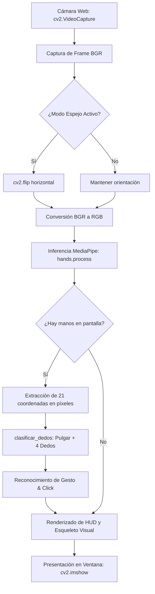
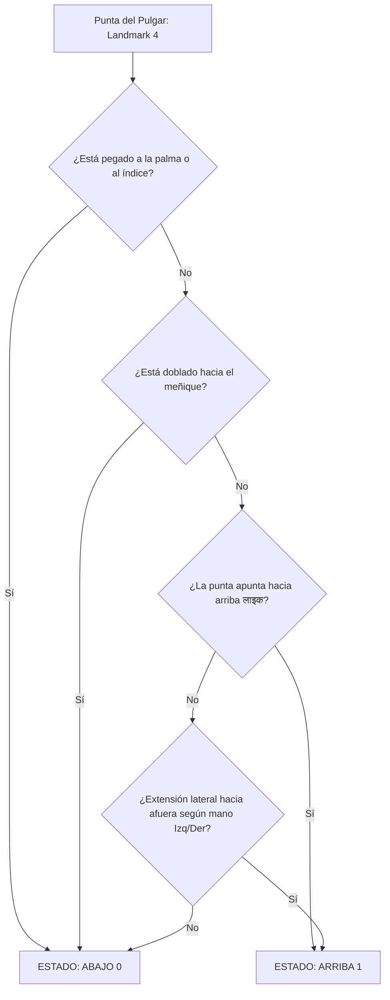

# 🖐️ MANUAL DE PRESENTACIÓN: DETECTOR Y CONTADOR DE DEDOS EN VIVO
> **Visión Artificial en Tiempo Real con Python, OpenCV y Google MediaPipe Hands**  
> *Script analizado:* [`detector_dedos.py`](../detector_dedos.py)

---

```
  ┌─────────────────────────────────────────────────────────────────────────────┐
  │                           ÍNDICE DE LA PRESENTACIÓN                         │
  ├─────────────────────────────────────────────────────────────────────────────┤
  │  SLIDE 01 │ Portada & Visión General de la Solución de Visión por Computador │
  │  SLIDE 02 │ Arquitectura del Pipeline: Cámara Web -> MediaPipe -> HUD       │
  │  SLIDE 03 │ El Modelo Anatómico: Los 21 Landmarks de la Mano Humana         │
  │  SLIDE 04 │ Algoritmo de Detección para Índice, Medio, Anular y Meñique     │
  │  SLIDE 05 │ Cinemática Avanzada del Pulgar (Geometría Relativa y Escala)    │
  │  SLIDE 06 │ Motor de Reconocimiento de Gestos Naturales (Paz, Like, Rock...)│
  │  SLIDE 07 │ Detección de Pellizco y Click Virtual (Distancia Euclidiana)    │
  │  SLIDE 08 │ Diseño de la Interfaz HUD (Heads-Up Display) en Tiempo Real     │
  │  SLIDE 09 │ Atajos de Teclado y Controles en Vivo ([M] Mirror, [S] Foto)    │
  │  SLIDE 10 │ Rendimiento, Optimización de FPS y Aplicaciones Futuras (HMI)   │
  └─────────────────────────────────────────────────────────────────────────────┘
```

---

<!-- SLIDE 01 -->
## 👁️ SLIDE 01: Visión General del Detector de Dedos

```
   [ CÁMARA WEB ] ────────> Captura de Video 720p @ 30 FPS
         │
         ▼
 ┌─────────────────────────────────────────────────────────────────────────────┐
 │                         GOOGLE MEDIAPIPE HANDS                              │
 │   1. Detector de Palma (Palm Detection)                                     │
 │   2. Estimador de Puntos Clave 3D (21 Landmarks por Mano)                   │
 └──────────────────────────────────────┬──────────────────────────────────────┘
                                        │
                                        ▼
 ┌─────────────────────────────────────────────────────────────────────────────┐
 │                     MOTOR MATEMÁTICO ("detector_dedos.py")                   │
 │   * Estado booleano de cada dedo: Pulgar, Índice, Medio, Anular, Meñique    │
 │   * Conteo individual y acumulado de 0 a 10 dedos                           │
 │   * Clasificador de gestos naturales: Like, Paz, Rock, Shaka, Click         │
 └──────────────────────────────────────┬──────────────────────────────────────┘
                                        │
                                        ▼
                            [ PANTALLA HUD EN VIVO ]
                    Esqueleto anatómico + Panel de Métricas
```

### Capacidades Destacadas:
* **Doble Mano Simultánea:** Rastrea hasta 2 manos a la vez distinguiendo entre mano **Izquierda (Left)** y **Derecha (Right)**.
* **Precisión Inmune a la Distancia:** Normaliza todas las medidas con la **escala de la palma**, funcionando igual de bien a 30 cm o a 2 metros de la cámara.
* **Cero Latencia:** Corre fluidamente a más de **30 FPS** en procesadores convencionales sin necesidad de tarjetas gráficas dedicadas.

---

<!-- SLIDE 02 -->
## ⚙️ SLIDE 02: Arquitectura del Pipeline de Procesamiento



---

<!-- SLIDE 03 -->
## 🖐️ SLIDE 03: Los 21 Landmarks Anatómicos de la Mano

Google MediaPipe mapea la mano en una malla tridimensional de **21 puntos clave**:

```
                          8 (Punta Índice)   12 (Punta Medio)   16 (Punta Anular)   20 (Punta Meñique)
                                 │                  │                  │                  │
                          7 (DIP)            11 (DIP)           15 (DIP)           19 (DIP)
                                 │                  │                  │                  │
                          6 (PIP)            10 (PIP)           14 (PIP)           18 (PIP)
                                 │                  │                  │                  │
   4 (Punta Pulgar)       5 (MCP)            9 (MCP)            13 (MCP)           17 (MCP)
          │                      └──────────────────┼──────────────────┘                  │
       3 (IP)                                       │                                     │
          │                                         │                                     │
       2 (MCP)                                      │                                     │
          │                                         │                                     │
       1 (CMC) ─────────────────────────────────────┴─────────────────────────────────────┘
                                                    │
                                                 0 (Muñeca / Wrist)
```

### Grupos de Puntos Clave en `detector_dedos.py`:
```python
PUNTAS_IDS = [4, 8, 12, 16, 20]  # Puntas: Pulgar, Índice, Medio, Anular, Meñique
PIP_IDS    = [2, 6, 10, 14, 18]  # Articulaciones Interfalángicas Proximales (Nudillos medios)
```

---

<!-- SLIDE 04 -->
## 📏 SLIDE 04: Detección de los 4 Dedos Principales

Para los dedos **Índice, Medio, Anular y Meñique**, la mecánica es puramente gravitacional y vertical en el eje $Y$:

```
          Punta (TIP: ID 8)               ─── y = 120 px  (Arriba en pantalla)
                 │
                 │   ¿tip_y < pip_y?  ──>  ¡SÍ!  ===>  DEDO ARRIBA [1]
                 ▼
        Articulación (PIP: ID 6)          ─── y = 240 px  (Más abajo en pantalla)
```

```python
# Analizar los 4 dedos superiores (Índice=1, Medio=2, Anular=3, Meñique=4)
for i in range(1, 5):
    tip_y = puntos_px[PUNTAS_IDS[i]][1]  # Coordenada Y de la punta
    pip_y = puntos_px[PIP_IDS[i]][1]     # Coordenada Y de la articulación media
    
    # En coordenadas de imagen, Y=0 está en el borde SUPERIOR de la pantalla
    if tip_y < pip_y:
        estados[i] = 1  # Dedo extendido hacia arriba
    else:
        estados[i] = 0  # Dedo doblado o cerrado
```

> [!NOTE]
> En OpenCV, el origen $(0, 0)$ está en la **esquina superior izquierda**. Por eso, un valor menor de $Y$ significa que el punto está **físicamente más arriba**.

---

<!-- SLIDE 05 -->
## 🧠 SLIDE 05: Cinemática Avanzada del Pulgar

El pulgar humano no se mueve hacia arriba y abajo como los otros cuatro dedos; **rota lateralmente sobre la articulación carpometacarpiana**.  
Un simple test vertical $Y$ fallaría el 60% de las veces.



### El Cálculo Geométrico Normalizado:
```python
# 1. Escala de referencia de la mano (distancia de la muñeca al nudillo del dedo medio)
ref_escala = distancia_euclidiana(p_wrist, puntos_px[9])

# 2. Si está pegado al dedo índice -> Doblado
cerca_de_la_mano = (dist_tip_index_mcp < ref_escala * 0.44)

# 3. Si la punta se acerca a la base del meñique -> Doblado hacia la palma
doblado_hacia_palma = dist_tip_pinky < (dist_ip_pinky * 1.05)

# 4. Caso A: Pulgar Arriba (Like vertical)
es_pulgar_arriba = (p_tip_thumb[1] < p_ip_thumb[1] < p_mcp_thumb[1])

# 5. Caso B: Extensión lateral según mano Izquierda o Derecha
if mano_rel == "Right":
    es_lateral = (p_tip_thumb[0] < p_ip_thumb[0])
else:
    es_lateral = (p_tip_thumb[0] > p_ip_thumb[0])
```

---

<!-- SLIDE 06 -->
## ✌️ SLIDE 06: Motor de Reconocimiento de Gestos Naturales

A partir del arreglo binario `estados = [Pulgar, Índice, Medio, Anular, Meñique]`, el script identifica el gesto humano:

```
  ┌────────────────────────┬─────────────────────┬──────────────────────────────┐
  │ GESTO RECONOCIDO       │ ARREGLO BINARIO     │ SIGNIFICADO / APLICACIÓN     │
  ├────────────────────────┼─────────────────────┼──────────────────────────────┤
  │ ✊ Puño Cerrado        │ [0, 0, 0, 0, 0]     │ Agarrar, Stop, Reposo (0)    │
  │ ☝️ Señalando (1)       │ [0, 1, 0, 0, 0]     │ Apuntar, Seleccionar ítem    │
  │ ✌️ Paz / Victoria (2)  │ [0, 1, 1, 0, 0]     │ Saludo, Confirmar (2)        │
  │ 🤟 Rock / Heavy Metal  │ [0, 1, 0, 0, 1]     │ Gesto juvenil / musical      │
  │ 🤙 Shaka / Surfer      │ [1, 0, 0, 0, 1]     │ Saludo surfer / Llamada      │
  │ 🔫 Pistola en L        │ [1, 1, 0, 0, 0]     │ Puntero direccional          │
  │ 👍 Pulgar Arriba       │ [1, 0, 0, 0, 0]     │ "Like", Aprobado             │
  │ 👎 Pulgar Abajo        │ [1, 0, 0, 0, 0]     │ "Dislike", Rechazado         │
  │ 🖐️ Mano Abierta (5)    │ [1, 1, 1, 1, 1]     │ Alto, Stop, Cinco dedos      │
  └────────────────────────┴─────────────────────┴──────────────────────────────┘
```

---

<!-- SLIDE 07 -->
## 🤏 SLIDE 07: Detección de Pellizco y Click Virtual

Permite usar la mano en el aire como si fuera un ratón de computadora (**Air Mouse**):

```
       Punta Pulgar (ID 4)         Punta Índice (ID 8)
                ●                         ●
                 \                       /
                  \   distancia_pinch   /
                   \                   /
                    ─────── ★ ────────
                      Centro del Click
```

```python
# Distancia euclidiana entre la punta del pulgar (4) y la punta del índice (8)
dist_pinch = distancia_euclidiana(puntos_px[4], puntos_px[8])
ref_escala = distancia_euclidiana(puntos_px[0], puntos_px[9])

# Si la distancia es menor al 28% del tamaño de la palma -> ¡CLICK!
pinch_activo = dist_pinch < max(24, int(ref_escala * 0.28))

if pinch_activo:
    gesto = "Click / Pellizco"
    # Dibuja un círculo amarillo brillante en el punto medio exacto
    mid = ((puntos_px[4][0] + puntos_px[8][0]) // 2, (puntos_px[4][1] + puntos_px[8][1]) // 2)
    cv2.circle(frame, mid, 16, (0, 255, 255), -1)
    cv2.putText(frame, "CLICK!", (mid[0] - 25, mid[1] - 20),
                cv2.FONT_HERSHEY_DUPLEX, 0.65, (0, 255, 255), 2)
```

---

<!-- SLIDE 08 -->
## 🖥️ SLIDE 08: Interfaz Gráfica HUD (Heads-Up Display)

Toda la información se proyecta sobre el fotograma de la cámara sin tapar la visión:

```
 ┌─────────────────────────────────────────────────────────────────────────────┐
 │ [DETECTOR DE DEDOS Y GESTOS - MEDIAPIPE]               FPS: 30 | Espejo: ON │ <── Barra Superior
 ├─────────────────────────────────────────────────────────────────────────────┤
 │                                                 ┌─────────────────────────┐ │
 │                 🖐️ Mano Detectada              │ MANO RIGHT: 2 Dedos     │ │
 │                 (Esqueleto dibujado)            │ Gesto: Paz / Victoria   │ │ <── Tarjeta Lateral
 │                                                 │ Pulgar : ABAJO [0]      │ │     por cada mano
 │                                                 │ Indice : ARRIBA [1]     │ │
 │                 ● Verde = Dedo Levantado        │ Medio  : ARRIBA [1]     │ │
 │                 ● Rojo  = Dedo Doblado          │ Anular : ABAJO [0]      │ │
 │                                                 │ Menique: ABAJO [0]      │ │
 │                                                 └─────────────────────────┘ │
 ├─────────────────────────────────────────────────────────────────────────────┤
 │ [TOTAL DEDOS LEVANTADOS: 2]                                                 │ <── Barra Inferior
 └─────────────────────────────────────────────────────────────────────────────┘
```

* **Puntas de los dedos interactivas:** Círculos que cambian a **Verde brillante** si el dedo está arriba `[1]` o **Rojo** si está abajo `[0]`.
* **Esqueleto con degradado:** Huesos interconectados en color cian y naranja.

---

<!-- SLIDE 09 -->
## ⌨️ SLIDE 09: Controles Interactivos de Teclado

Durante la ejecución en vivo puedes presionar:

```
  ┌───────────┬─────────────────────────────────────────────────────────────────┐
  │ TECLA     │ ACCIÓN                                                          │
  ├───────────┼─────────────────────────────────────────────────────────────────┤
  │ [C]       │ Cambia de cámara en caliente (alterna entre cámara 0 y cámara 1)│
  │           │ sin necesidad de reiniciar el programa.                         │
  ├───────────┼─────────────────────────────────────────────────────────────────┤
  │ [M]       │ Alterna el Modo Espejo (Mirror On/Off con cv2.flip horizontal). │
  │           │ Facilita que tu mano izquierda coincida con el lado izquierdo.  │
  ├───────────┼─────────────────────────────────────────────────────────────────┤
  │ [S]       │ Captura y guarda una foto instantánea en alta resolución.       │
  │           │ Nombre de archivo: "captura_dedos_<timestamp>.jpg".             │
  ├───────────┼─────────────────────────────────────────────────────────────────┤
  │ [Q] / ESC │ Cierra limpiamente la cámara, libera los hilos de memoria y     │
  │           │ destruye las ventanas de OpenCV sin colgar el sistema.          │
  └───────────┴─────────────────────────────────────────────────────────────────┘
```

### Opciones de Ejecución por Consola:
```bash
# 1. Menú interactivo automático (detecta si hay cámara USB conectada):
python detector_dedos.py

# 2. Abrir directamente la cámara USB externa (índice 1):
python detector_dedos.py 1
# o también:
python detector_dedos.py --camera 1

# 3. Abrir directamente la cámara integrada de la laptop (índice 0):
python detector_dedos.py 0
```

---

<!-- SLIDE 10 -->
## 🚀 SLIDE 10: Rendimiento y Futuras Integraciones (HMI)

```
  ┌─────────────────────────────────────────────────────────────────────────────┐
  │                         MÉTRICAS DE RENDIMIENTO                             │
  ├───────────────────────────────────┬─────────────────────────────────────────┤
  │ Resolución de Procesamiento       │ 1280 x 720 px (HD 720p)                 │
  │ Tasa de Cuadros Promedio          │ 28 a 34 FPS (Fluido en tiempo real)     │
  │ Retardo de Inferencia (Latencia)  │ ~18 ms por cuadro                       │
  │ Umbral de Detección / Tracking    │ 0.6 / 0.5 (Sin saltos ni vibraciones)   │
  └───────────────────────────────────┴─────────────────────────────────────────┘
```

### Puentes hacia el Hardware (ESP32 + LoRa):
Este script en Python puede conectarse mediante el puerto Serie con el ESP32:
* **Gesto "1" o Señalando:** Enviar `'UNO'` por serial $\rightarrow$ Transmitir por LoRa $\rightarrow$ Prender LEDs remotos.
* **Gesto "2" o Paz:** Enviar `'DOS'` por serial $\rightarrow$ Transmitir por LoRa $\rightarrow$ Apagar LEDs remotos.
* **Gesto de Click / Pellizco:** Activar un relé o disparar la captura de la cámara en el ESP32-S3 CAM.

---
> 💡 *Manual generado y almacenado en:* `MANUAL_MEDIAPIPE/PRESENTACION_DETECTOR_DEDOS.md`
